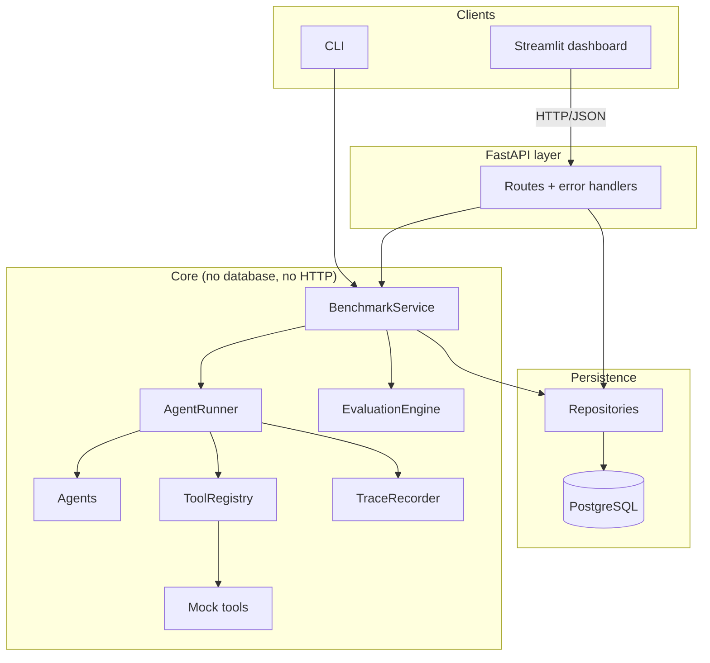
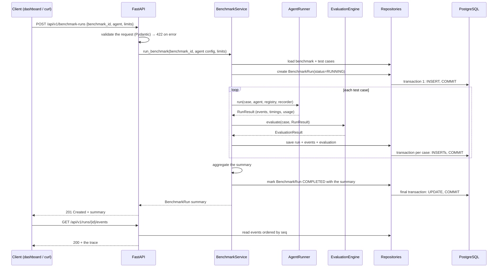
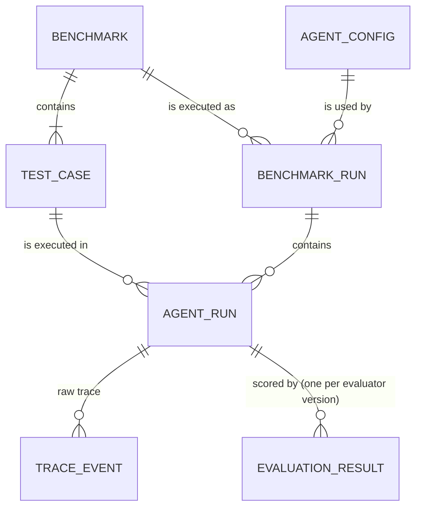

# AgentBench Architecture (MVP)

> **Status: Approved (2026-10-27). Not yet implemented.**
> When a component lands, its section is updated to describe what actually exists.

## 1. Purpose

AgentBench runs tool-using AI agents against fixed benchmarks, records every step they
take, scores the results with deterministic rules, and lets a developer compare two
agent configurations. Every number it reports must be traceable to a recorded run.

## 2. MVP scope

**In scope**

- Benchmarks defined in YAML files: a set of test cases, each with a task input, the
  tools the agent may use, execution limits, and deterministic expectations.
- An `Agent` interface plus two deterministic agents used for development and testing:
  - `ScriptedAgent` replays a fixed sequence of decisions from the test case.
  - `RuleBasedAgent` chooses tools with simple, hand-written rules.
- Deterministic mock tools (calculator, key-value lookup, document search over a fixed
  corpus) with configurable fault injection: delays, failures, invalid output.
- A controlled execution loop with a step limit, per-tool timeouts, a whole-run timeout,
  and bounded retries.
- An ordered event trace for every run.
- Deterministic evaluation: task success, tool correctness, latency, token usage, and
  estimated cost, all reported separately.
- Benchmark-level aggregation and a case-by-case comparison of two benchmark runs.
- PostgreSQL persistence, a FastAPI HTTP API, a command-line interface, and a Streamlit
  dashboard.

**Non-goals for the MVP**

- Real LLM providers. One model adapter is added after the core works (milestone M12).
- LLM-as-judge or any other non-deterministic scoring.
- Statistical significance testing across repeated runs. Deterministic agents have no
  variance; this becomes necessary once real models arrive.
- Parallel tool calls within one step, or multi-agent systems.
- Running benchmarks in the background on a job queue. No Celery, Redis or workers.
- Authentication, multiple users, or hosting the API publicly. The API binds to localhost.
- Running model-generated code, or sandboxing arbitrary tools.
- Exporting traces to OpenTelemetry.

## 3. Components

The system is a **modular monolith**: one Python package and one deployable process for
the API, with strict import rules between modules. The Streamlit dashboard is a second
process, but it only talks to the API.

| Component | Module | Why it exists | Depends on |
|-----------|--------|---------------|------------|
| Domain models | `domain/` | One shared vocabulary of Pydantic types (test case, tool call, run result, …) used by every other module | — |
| `ToolRegistry` | `tools/` | Decides which tools a run may use and rejects invalid arguments *before* a tool executes. Agent output is untrusted input. | domain |
| Agents | `agents/` | Hides *who* makes decisions (a script, rules, later an LLM) behind one interface, so the runner never changes | domain |
| `TraceRecorder` | `tracing/` | Writes an ordered, append-only list of what happened. This is the evidence that every metric and debugging view is built from. | domain |
| `AgentRunner` | `runner/` | Runs the decide → validate → execute → observe loop and enforces every limit. It is the only place a run can stop. | domain, tools, agents, tracing |
| `EvaluationEngine` | `evaluation/` | Turns a test case plus a finished run into a verdict and metrics. Because it is a pure function, stored runs can be scored again later. | domain |
| `BenchmarkService` | `benchmarks/` | Orchestrates one benchmark run: for each case it runs, evaluates and saves, then aggregates and compares | all of the above, plus the persistence interfaces |
| Repository layer | `persistence/` | Keeps SQL and transactions out of the business logic | domain, SQLAlchemy |
| FastAPI layer | `api/` | The documented HTTP boundary: validation, status codes, error format | benchmarks, persistence |
| CLI | `cli.py` | Run a benchmark from the terminal; useful before the API exists, and for CI | benchmarks |
| Streamlit dashboard | `dashboard/` | Shows runs, failures, metrics and comparisons | the HTTP API only |

**Import rules**, to be enforced by a test:

- `runner/` never imports `persistence/`, `evaluation/`, or `api/`. A run can be executed
  and tested with no database at all.
- `evaluation/` never imports `runner/`. It reads finished results, not live state.
- `dashboard/` imports nothing from `agentbench` except its HTTP client.



## 4. How a run works

### 4.1 The execution loop (`AgentRunner`)

```
history = [task input]
for step in 1..max_steps:
    check the whole-run deadline              → stop with RUN_TIMEOUT
    decision = agent.decide(history)          (the agent reports its own token usage)
    record AGENT_DECISION
    if decision is a final answer:
        record FINAL_ANSWER                   → stop with COMPLETED
    validate decision.tool_call with ToolRegistry
        unknown tool / invalid arguments      → record a VALIDATION_ERROR event
                                                and pass the error back to the agent
                                                as an observation (it is never retried)
    for attempt in 1..max_retries+1:
        record TOOL_CALL_STARTED
        run the tool with a per-call timeout
        success                               → record TOOL_CALL_SUCCEEDED, stop retrying
        retryable failure (timeout, transient) → record TOOL_CALL_FAILED, back off, retry
        permanent failure                     → record TOOL_CALL_FAILED, stop retrying
    all retries used up                       → stop with TOOL_FAILURE_EXHAUSTED
    history += observation
loop finished without a final answer          → stop with MAX_STEPS_EXCEEDED
agent raised an exception                     → stop with AGENT_ERROR
bug in the runner's own code                  → stop with HARNESS_ERROR
```

The runner returns a `RunResult`: status, `TerminationReason`, the final answer if there
is one, the event list, and summed timing and usage. **Only a `COMPLETED` run can pass
evaluation.** Any other termination reason means the case fails, and that reason is
reported. Nothing is silently turned into a success. `HARNESS_ERROR` marks a fault in
AgentBench rather than in the agent, so those runs are excluded from pass rates.

**Concurrency choice.** Agents and tools are `async`. The runner wraps each tool call in
`asyncio.wait_for(...)`, which cancels a timed-out call cleanly whenever the tool is
waiting on I/O — which real HTTP-based tools will be. The rest of the system
(persistence, the service) is synchronous; `BenchmarkService` calls
`asyncio.run(runner.run(case))` once per case. See risk R1.

### 4.2 A concrete example

The test case says: "What is 17% of the inventory count for SKU A-12?" The allowed tools
are `kv_lookup` and `calculator`, and the expected answer is `20.4` (within ±0.01).

| seq | event | detail |
|-----|-------|--------|
| 0 | RUN_STARTED | limits: max_steps=5, tool_timeout=2s |
| 1 | AGENT_DECISION | call `kv_lookup(key="inventory:A-12")` |
| 2 | TOOL_CALL_STARTED | attempt 1 |
| 3 | TOOL_CALL_SUCCEEDED | `120`, 3 ms |
| 4 | AGENT_DECISION | call `calculator(expression="120 * 0.17")` |
| 5 | TOOL_CALL_STARTED | attempt 1 |
| 6 | TOOL_CALL_SUCCEEDED | `20.4`, 1 ms |
| 7 | AGENT_DECISION | final answer `20.4` |
| 8 | FINAL_ANSWER | `20.4` |
| 9 | RUN_FINISHED | COMPLETED, 2 tool calls |

Evaluation results:
- the answer check passes;
- the required-tools check passes;
- tool correctness is 2 valid calls out of 2;
- latency and token totals come from the events.

`calculator` parses arithmetic with a restricted parser. It never calls `eval`.

### 4.3 End-to-end request flow



The CLI follows the same path but calls `BenchmarkService` directly instead of going
through HTTP.

## 5. Directory structure

```
agentbench/
├── src/agentbench/
│   ├── domain/          models.py (Pydantic entities, enums), errors.py
│   ├── tools/           base.py (Tool protocol), registry.py, mock/ (calculator, kv_lookup, search, faults)
│   ├── agents/          base.py (Agent protocol), scripted.py, rule_based.py, factory.py
│   ├── tracing/         events.py (event types), recorder.py
│   ├── runner/          limits.py (RunLimits, RetryPolicy), runner.py (AgentRunner)
│   ├── evaluation/      checks.py, engine.py, metrics.py, pricing.py
│   ├── benchmarks/      loader.py (YAML → domain), service.py, compare.py
│   ├── persistence/     db.py (engine/session), orm.py (tables), repositories.py
│   ├── api/             app.py, deps.py, errors.py, schemas.py, routes/
│   ├── dashboard/       app.py, client.py
│   └── cli.py
├── migrations/          Alembic
├── examples/benchmarks/ example YAML benchmarks
├── tests/
│   ├── unit/            no database, no network
│   ├── integration/     PostgreSQL, API
│   └── e2e/             CLI/API → DB → API read-back
├── docs/                architecture.md, decisions/ (ADRs)
├── compose.yaml         PostgreSQL (M8), then the full stack (M11)
└── pyproject.toml
```

## 6. Core entities

The full design — columns, constraints, indexes, event ordering and data retention — is in
[data-model.md](data-model.md). This section gives the shape of it.



Key rules:

- **Benchmarks are immutable.** `(name, version)` is unique, and `content_hash` is computed
  from the canonical definition.
  - Registering the same name, version *and* content again returns the existing
    benchmark.
  - Different content under the same name and version is rejected with 409.
  - Comparisons are only allowed between benchmark runs of the same benchmark.
- **Agent configurations are immutable and content-hashed** (`AGENT_CONFIG`), so every
  run of the same configuration can be grouped and compared.
- **`AGENT_RUN` is one test case executed once.** `BENCHMARK_RUN` is one execution of a
  whole benchmark with one agent configuration.
- **Execution status and verdict are separate.**
  - `AGENT_RUN.status` (`COMPLETED` / `FAILED` / `ERROR`) and `termination_reason` say
    how execution ended.
  - `EVALUATION_RESULT.passed` and `failure_category` say whether the agent was right.
  - A run can complete normally and still give a wrong answer.
  - `ERROR` (`HARNESS_ERROR`) means AgentBench itself failed. Such runs are excluded
    from pass rates and reported separately.
- **The trace is facts; the evaluation is a judgement.**
  - `AGENT_RUN` and `TRACE_EVENT` are written once and never changed.
  - `EVALUATION_RESULT` is written once per evaluator version. Re-scoring adds rows and
    never overwrites.
- **Event order is explicit.** `TRACE_EVENT` is keyed by `(agent_run_id, seq)`. `seq`
  is assigned by the recorder, never inferred from timestamps.
- **Fields that are filtered or sorted on are real columns**: status, passed, duration,
  tokens, cost. Fields that are only displayed (payloads, check details) are JSONB.
- **Everything that produced a number is recorded**: `agent_version`, `evaluator_version`,
  `pricing_version`, `git_sha`.

**Pricing and cost.** Token counts are facts and are stored on `AGENT_RUN`. `NULL` means
"not reported", which is different from 0. Cost is `tokens × price` from a versioned
price table in `evaluation/pricing.py`. It is stored on `EVALUATION_RESULT` together
with `pricing_version`, and is always labelled *estimated*. Deterministic agents either
report no usage or a declared *simulated* usage, which is labelled as such.

## 7. API design

All routes are under `/api/v1`. OpenAPI documentation is generated by FastAPI.

| Method | Path | Purpose | Success | Errors |
|--------|------|---------|---------|--------|
| GET | `/health` | Liveness check plus a database ping | 200 | 503 |
| POST | `/benchmarks` | Register a benchmark definition | 201 | 409 (same name and version, different hash), 422 |
| GET | `/benchmarks` | List benchmarks (`limit`, `offset`) | 200 | 422 |
| GET | `/benchmarks/{id}` | One benchmark and its test cases | 200 | 404 |
| GET | `/agents` | Agent types that can be run | 200 | — |
| GET | `/tools` | Registered tools and their argument JSON schemas | 200 | — |
| POST | `/benchmark-runs` | Run a benchmark synchronously and return its summary | 201 | 404, 413 (too many cases), 422 |
| GET | `/benchmark-runs` | List benchmark runs (filter by `benchmark_id`) | 200 | 422 |
| GET | `/benchmark-runs/{id}` | Summary plus per-case status and verdict | 200 | 404 |
| GET | `/runs/{id}` | One run with its evaluation | 200 | 404 |
| GET | `/runs/{id}/events` | The ordered trace | 200 | 404 |
| GET | `/comparisons?baseline_id=&candidate_id=` | Metric changes and per-case fixed/broken lists | 200 | 404, 422 (different benchmark versions) |

**Agent selection is by registered name only**, for example
`{"agent": {"type": "scripted", "params": {...}}}`. The API never imports a module path
supplied by the client.

**Error format.** Every error uses the same body:

```json
{"error": {"code": "benchmark_not_found", "message": "Benchmark 3f… does not exist", "details": {}}}
```

Domain exceptions (`NotFoundError`, `ConflictError`, `BenchmarkVersionMismatch`, …) are
defined in `domain/errors.py`. They are mapped to status codes in one place,
`api/errors.py`. Unexpected exceptions become a 500 with a generic message. The stack
trace is logged on the server and never returned to the client.

**Error categories inside a run.** These are not HTTP errors; they are recorded in the
trace:

| Category | Example | Retried? | Effect |
|----------|---------|----------|--------|
| Validation error | Unknown tool, missing or invalid argument | No | Returned to the agent as an observation; counts against tool correctness |
| Transient tool error | Timeout, injected transient failure | Yes, bounded, with backoff | Repeated failure → `TOOL_FAILURE_EXHAUSTED` |
| Permanent tool error | Tool reports an invalid request | No | Returned to the agent as an observation |
| Agent error | Exception inside `agent.decide` | No | `AGENT_ERROR` |
| Harness error | Bug in AgentBench's own code during a run | No | `HARNESS_ERROR`; the run is excluded from the pass rate |
| Limit reached | Step limit or run deadline | — | `MAX_STEPS_EXCEEDED` / `RUN_TIMEOUT` |

## 8. Transactions and persistence

| Operation | Transaction boundary | Reason |
|-----------|---------------------|--------|
| Register a benchmark | One transaction for the benchmark row and all its test cases | All or nothing; a half-registered benchmark is never visible |
| Start a benchmark run | Get or create the `AGENT_CONFIG`, insert `BENCHMARK_RUN(status=RUNNING)`, and commit immediately | The run is visible straight away, and a crash leaves evidence behind |
| Finish one test case | One transaction for `AGENT_RUN` + all `TRACE_EVENT`s + `EVALUATION_RESULT` | A case is saved completely or not at all; earlier cases survive a crash later on |
| Finish a benchmark run | One transaction updating the status and summary | — |

**Rejected alternatives**

- *One transaction for the whole benchmark.* It would hold a long transaction open and
  lose every result when the last case fails.
- *Commit after every event.* It would be slow, and a crashed case would leave a partial
  trace that looks real.

**Accepted trade-off.** If the process crashes in the middle of a case, that case's trace
is lost and the benchmark run stays `RUNNING`. A CLI command will mark such runs as
`ABORTED`.

**Other decisions**

- **SQLAlchemy 2.x, synchronous**, with psycopg 3. Async SQLAlchemy adds concepts but no
  benefit at this scale.
- **ORM models are separate from the Pydantic domain models.** Repositories translate
  between them. This duplicates field definitions, but the domain never depends on the
  database.
- **Alembic migrations from the first table.** Tables are never created with
  `create_all` outside tests.
- **PostgreSQL is used in integration tests too**: locally via Docker Compose, and as a
  service container in GitHub Actions. SQLite is not used as a stand-in, because its
  JSON, timestamp and constraint behaviour differs from PostgreSQL.

## 9. Testing strategy

| Layer | What is tested | How |
|-------|----------------|-----|
| Unit | Registry validation, each mock tool, fault injection | pytest, `parametrize` tables of valid and invalid arguments |
| Unit | Every runner termination path: completed, step limit, run timeout, retries succeed, retries exhausted, validation error, agent error | Scripted agents plus fault-injecting tools; time limits in milliseconds to keep tests fast |
| Unit | Every evaluation check, aggregation, comparison | Table-driven; hand-built `RunResult` inputs, no runner involved |
| Unit | Determinism | Run the same case twice; the traces are identical after removing ids and timestamps. A golden trace file is committed. |
| Unit | Import rules | A test inspects imports and fails if `runner/` imports `persistence/`, and so on |
| Integration | Repositories and transaction boundaries | PostgreSQL; each test runs inside a transaction that is rolled back; a crash mid-case leaves no partial run |
| Integration | Migrations | Upgrade an empty database to the latest migration; the schema matches the ORM |
| Integration | API | FastAPI `TestClient` against PostgreSQL: status codes, error bodies, pagination |
| End-to-end | Register benchmark → run → read back via API | One example benchmark through the CLI and through the API |
| Dashboard | API client functions | Unit tests with a fake HTTP transport; no browser UI tests in the MVP |

Rules:
- No test calls a live LLM API.
- When the model adapter arrives (M12), it is tested against recorded responses.

## 10. Risks and alternatives

| # | Risk | Mitigation | Alternative considered |
|---|------|------------|------------------------|
| R1 | Python cannot forcibly stop CPU-bound code, so a timeout cannot interrupt a busy synchronous tool | Tools are `async` and mock tools never block; a timeout is still recorded even if a tool ignores cancellation | Run tools in subprocesses that can be killed — correct, but heavier; revisit if untrusted tools appear |
| R2 | The agent interface turns out too narrow for real LLM tool calling (parallel calls, multi-part messages) | The agent receives the full history; a decision type can grow into a list later | Model on one provider's message format — rejected because it ties the core to one vendor |
| R3 | Real LLMs are non-deterministic, so one run per case can mislead | Out of the MVP; `AGENT_RUN.repeat_index` exists now so repeated runs can be stored and grouped later | Build statistics in now — premature |
| R4 | `POST /benchmark-runs` is synchronous; a long benchmark could exceed HTTP timeouts | Cap the number of cases (413); mock tools take milliseconds; the CLI handles large runs | Job queue (Celery/RQ + Redis) — adds two services with no current need |
| R5 | JSON columns make some queries hard | Promote a field to a real column when a query needs it | Fully normalised tables for checks and payloads — more migrations, little benefit now |
| R6 | Deterministic checks cannot score open-ended answers | Benchmarks are designed with checkable answers (numbers, ids, exact facts) | LLM-as-judge — a non-goal; non-deterministic |
| R7 | Scope is large for one developer | Each milestone is usable on its own: the CLI works before the API, and the API before the dashboard | — |
| R8 | Model prices change, so old cost estimates drift | The price table is versioned and its version is stored with each result | — |

**Frameworks not used**

- **LangChain / LangGraph.** They would hide the loop that AgentBench exists to measure,
  and add a large dependency to the core.
- **OpenTelemetry.** A good *export format* later, but too much machinery for the
  internal trace.

## 11. Milestones and acceptance criteria

Each milestone ends with green CI and passing tests that demonstrate its criteria.

| Milestone | Delivers | Acceptance criteria (all tested) |
|-----------|----------|----------------------------------|
| M2 | Domain models | Pydantic models for test cases, tool calls, decisions, run results, events and evaluations; invalid data raises `ValidationError`; models round-trip through JSON unchanged |
| M3 | Tools + `ToolRegistry` | Unknown tool → `UnknownToolError`; invalid arguments → `ToolValidationError` with field details; a tool outside the case's allow-list is rejected; `calculator` rejects non-arithmetic input such as `__import__('os')`; fault injection produces delays and failures on demand |
| M4 | `AgentRunner` + `TraceRecorder` | One test per termination reason; retries never exceed `max_retries`; a tool slower than its timeout is cancelled and recorded; event `seq` values are 0..n with no gaps; two identical runs produce identical normalised traces |
| M5 | `EvaluationEngine` | Each check type has passing and failing tests; a non-`COMPLETED` run never passes; latency, tokens and cost are reported as separate fields; re-scoring a stored `RunResult` gives the same result |
| M6 | YAML loader + `BenchmarkService` (in memory) + CLI | `agentbench run examples/benchmarks/inventory.yaml --agent scripted` prints per-case verdicts and a summary and writes JSON; invalid YAML gives a clear error and a non-zero exit code; comparing two runs lists the cases that were fixed and the cases that broke |
| M7 | Persistence + Alembic + Compose PostgreSQL | Migrations upgrade an empty database; repositories save and load every entity; a crash injected mid-case leaves no partial run; CI runs integration tests against a PostgreSQL service container |
| M8 | FastAPI | Every endpoint in §7 has tests for success and documented errors; error bodies match the standard format; the OpenAPI schema is generated; 500s never contain stack traces |
| M9 | Streamlit dashboard | Lists benchmark runs; shows one run's ordered trace with the failing step highlighted; shows a comparison between two benchmark runs; works with only the API URL configured |
| M10 | Docker Compose for the full stack + CI hardening | `docker compose up` starts the database, API and dashboard; the README quick-start works from a clean clone; CI caches dependencies |
| M11 | Benchmark content | At least two example benchmarks covering success, tool failure and limit cases, with results documented in the README |
| M12 | First real model adapter | Implements the `Agent` protocol; reports real token usage; tests use recorded responses only; credentials come from environment variables and are never logged |

**Progress (2026-10-27):** M2, M3 and M4 are implemented. Persisting runs and traces (the
`agent_run` and `trace_event` part of M7) was brought forward on request, together with
migrations, PostgreSQL integration tests in CI, and a CLI to run single tasks. See
[runner.md](runner.md) for what exists, and data-model.md §7 for how it differs from the
design.

Compared with the original roadmap, the **in-memory benchmark run + CLI (M6) now comes
before persistence**. Trace recording is merged into the runner milestone, because the
runner cannot be tested without it.
