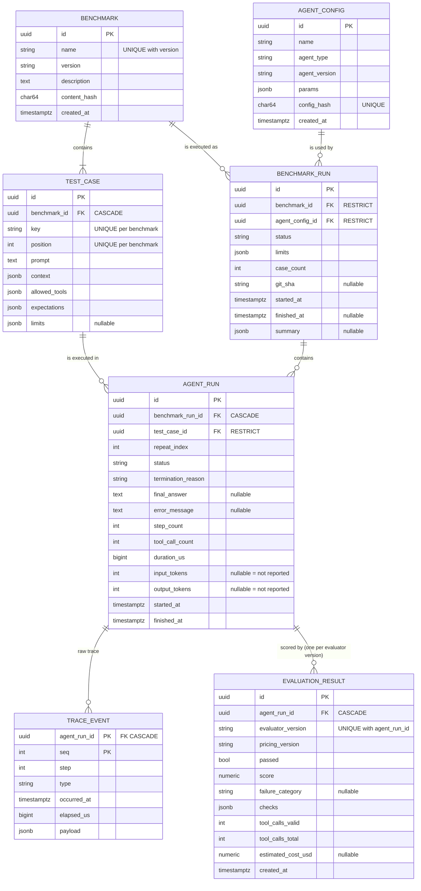

# AgentBench Data Model

> **Status: Approved (2026-10-27).** This document refines §6 and §8 of
> [architecture.md](architecture.md). Not yet implemented.

## 1. Changes from the approved architecture

These were approved on 2026-10-27, and `architecture.md` has been updated to match.

| # | Change | Reason |
|---|--------|--------|
| C1 | `RUN` is renamed `AGENT_RUN` | Clearer name; matches "one agent executing one test case" |
| C2 | New `AGENT_CONFIG` table replaces the `agent_spec` JSON on `BENCHMARK_RUN` | Comparing "prompt A vs prompt B" needs a stable identity for each configuration; it is content-hashed like benchmarks |
| C3 | Estimated cost moves from the run to `EVALUATION_RESULT`, together with `pricing_version` | Token counts are *facts* about a run; cost is an *interpretation* that depends on a price table that changes over time |
| C4 | A run may have several evaluations, one per `evaluator_version`. This replaces the "at most one" relationship. | Re-scoring keeps history instead of overwriting it |
| C5 | New termination reason `HARNESS_ERROR` and run status `ERROR` | A bug in AgentBench itself must not count as the agent's failure |
| C6 | `TRACE_EVENT` uses the composite primary key `(agent_run_id, seq)` instead of a UUID | The natural key already identifies an event and defines its order |

## 2. Entities



### 2.1 What each entity means

- **Benchmark** — a named, versioned, *immutable* collection of test cases.
  - `content_hash` is the SHA-256 of the canonical JSON form of the definition: keys
    sorted, no whitespace.
- **TestCase** — one task:
  - the prompt plus optional structured `context`;
  - the tools it may use (`allowed_tools`);
  - the deterministic `expectations`, validated by the Pydantic `Expectations` model on
    write;
  - optional `limits` overrides.

  `key` is a human-readable slug such as `inventory-percent`. `position` fixes the run
  order.
- **AgentConfig** — which agent implementation (`agent_type`, `agent_version`) was run with
  which `params`. It is immutable and content-hashed, so the same configuration always
  maps to the same row.
- **BenchmarkRun** — one execution of one benchmark with one agent configuration.
  - It is the only mutable entity: `status`, `finished_at` and `summary` change once,
    when it finishes.
- **AgentRun** — one execution of one test case.
  - It holds execution *facts*: how it ended, timings, step counts, reported token usage.
  - It is written once and never updated.
- **TraceEvent** — one ordered fact within an agent run. Written once, never updated.
- **EvaluationResult** — a judgement of one agent run by one evaluator version: the
  verdict, the per-check details, the failure category, and the estimated cost. Written
  once. A new evaluator version adds a new row.

### 2.2 Status fields

| Field | Values | Meaning |
|-------|--------|---------|
| `BenchmarkRun.status` | `RUNNING`, `COMPLETED`, `ABORTED` | `COMPLETED` = every case was executed and saved, *whatever the verdicts*. `ABORTED` = the process stopped or crashed; it is set by `agentbench abort-stale`. |
| `AgentRun.status` | `COMPLETED`, `FAILED`, `ERROR` | `COMPLETED` = the agent gave a final answer. `FAILED` = the run stopped because of the agent or its tools. `ERROR` = AgentBench itself failed (`HARNESS_ERROR`). |
| `AgentRun.termination_reason` | `COMPLETED`, `MAX_STEPS_EXCEEDED`, `RUN_TIMEOUT`, `TOOL_FAILURE_EXHAUSTED`, `AGENT_ERROR`, `HARNESS_ERROR` | Exactly why the loop stopped. A CHECK constraint ties it to `status`. |
| `EvaluationResult.passed` | `true` / `false` | `true` only if the run is `COMPLETED` **and** every check passed |
| `EvaluationResult.failure_category` | `WRONG_ANSWER`, `MISSING_REQUIRED_TOOL`, `FORBIDDEN_TOOL_USED`, `INVALID_TOOL_CALL`, `TOOL_CALL_LIMIT_EXCEEDED`, `TOOL_FAILURE`, `STEP_LIMIT`, `TIMEOUT`, `AGENT_ERROR`, `HARNESS_ERROR` | The single *primary* reason for failure, chosen by a fixed precedence (§5.3). `NULL` exactly when the run passed. |

**Runs with harness errors are excluded from the pass rate** and reported separately as
`invalid_runs`. If any are present, the summary is flagged, because the result reflects
a fault in AgentBench and says nothing about the agent.

## 3. SQLAlchemy models

Design notes:

- **Enums are stored as `VARCHAR` with a CHECK constraint** (`native_enum=False`), not as
  PostgreSQL `ENUM` types. Adding a value to a native enum needs `ALTER TYPE`, which is
  awkward in migrations; changing a CHECK constraint is simple.
- **Timestamps are `timestamptz`, always UTC**, used only to say *when* something
  happened.
- **Durations come from a monotonic clock** and are stored as integer microseconds
  (`duration_us`, `elapsed_us`). They are never computed by subtracting wall-clock
  timestamps, because the system clock can jump.
- **PostgreSQL does not index foreign keys automatically.** Every foreign key used in a
  join or a cascade delete is the leading column of some index.
- **UUIDs are generated in Python** (`uuid4`), not by the database. The runner can create
  ids in memory before anything is saved.

```python
# Shared enums — used by the ORM, the API schemas, and the domain models.
from enum import StrEnum


class BenchmarkRunStatus(StrEnum):
    RUNNING = "RUNNING"
    COMPLETED = "COMPLETED"
    ABORTED = "ABORTED"


class AgentRunStatus(StrEnum):
    COMPLETED = "COMPLETED"
    FAILED = "FAILED"
    ERROR = "ERROR"


class TerminationReason(StrEnum):
    COMPLETED = "COMPLETED"
    MAX_STEPS_EXCEEDED = "MAX_STEPS_EXCEEDED"
    RUN_TIMEOUT = "RUN_TIMEOUT"
    TOOL_FAILURE_EXHAUSTED = "TOOL_FAILURE_EXHAUSTED"
    AGENT_ERROR = "AGENT_ERROR"
    HARNESS_ERROR = "HARNESS_ERROR"


class TraceEventType(StrEnum):
    RUN_STARTED = "RUN_STARTED"  # task start
    AGENT_DECISION = "AGENT_DECISION"
    TOOL_CALL_STARTED = "TOOL_CALL_STARTED"  # tool call
    TOOL_CALL_SUCCEEDED = "TOOL_CALL_SUCCEEDED"  # tool result
    TOOL_CALL_FAILED = "TOOL_CALL_FAILED"  # error from a tool
    VALIDATION_ERROR = "VALIDATION_ERROR"  # error before a tool ran
    FINAL_ANSWER = "FINAL_ANSWER"
    RUN_FINISHED = "RUN_FINISHED"  # task completion (any outcome)


class FailureCategory(StrEnum):
    HARNESS_ERROR = "HARNESS_ERROR"
    AGENT_ERROR = "AGENT_ERROR"
    TIMEOUT = "TIMEOUT"
    STEP_LIMIT = "STEP_LIMIT"
    TOOL_FAILURE = "TOOL_FAILURE"
    FORBIDDEN_TOOL_USED = "FORBIDDEN_TOOL_USED"
    INVALID_TOOL_CALL = "INVALID_TOOL_CALL"
    TOOL_CALL_LIMIT_EXCEEDED = "TOOL_CALL_LIMIT_EXCEEDED"
    MISSING_REQUIRED_TOOL = "MISSING_REQUIRED_TOOL"
    WRONG_ANSWER = "WRONG_ANSWER"
```

```python
# persistence/orm.py (design sketch)
import uuid
from datetime import datetime
from decimal import Decimal
from typing import Any

from sqlalchemy import (
    BigInteger,
    CheckConstraint,
    DateTime,
    Enum,
    ForeignKey,
    Index,
    Integer,
    Numeric,
    String,
    Text,
    UniqueConstraint,
    func,
)
from sqlalchemy.dialects.postgresql import JSONB
from sqlalchemy.orm import DeclarativeBase, Mapped, mapped_column


def str_enum(enum_cls: type) -> Enum:
    return Enum(
        enum_cls,
        native_enum=False,
        create_constraint=True,
        length=32,
        validate_strings=True,
        name=f"ck_{enum_cls.__name__.lower()}",
    )


class Base(DeclarativeBase):
    pass


class BenchmarkRow(Base):
    __tablename__ = "benchmark"
    __table_args__ = (
        UniqueConstraint("name", "version", name="uq_benchmark_name_version"),
        CheckConstraint("length(name) > 0", name="ck_benchmark_name_nonempty"),
        CheckConstraint("length(content_hash) = 64", name="ck_benchmark_hash_len"),
    )

    id: Mapped[uuid.UUID] = mapped_column(primary_key=True)
    name: Mapped[str] = mapped_column(String(100))
    version: Mapped[str] = mapped_column(String(50))
    description: Mapped[str] = mapped_column(Text, default="")
    content_hash: Mapped[str] = mapped_column(String(64))
    created_at: Mapped[datetime] = mapped_column(
        DateTime(timezone=True), server_default=func.now()
    )


class TestCaseRow(Base):
    __tablename__ = "test_case"
    __table_args__ = (
        UniqueConstraint("benchmark_id", "key", name="uq_test_case_key"),
        UniqueConstraint("benchmark_id", "position", name="uq_test_case_position"),
        CheckConstraint("position >= 0", name="ck_test_case_position"),
    )

    id: Mapped[uuid.UUID] = mapped_column(primary_key=True)
    benchmark_id: Mapped[uuid.UUID] = mapped_column(
        ForeignKey("benchmark.id", ondelete="CASCADE")
    )
    key: Mapped[str] = mapped_column(String(100))
    position: Mapped[int] = mapped_column(Integer)
    prompt: Mapped[str] = mapped_column(Text)
    context: Mapped[dict[str, Any]] = mapped_column(JSONB, default=dict)
    allowed_tools: Mapped[list[str]] = mapped_column(JSONB)
    expectations: Mapped[dict[str, Any]] = mapped_column(JSONB)
    limits: Mapped[dict[str, Any] | None] = mapped_column(JSONB)


class AgentConfigRow(Base):
    __tablename__ = "agent_config"
    __table_args__ = (UniqueConstraint("config_hash", name="uq_agent_config_hash"),)

    id: Mapped[uuid.UUID] = mapped_column(primary_key=True)
    name: Mapped[str] = mapped_column(String(100))
    agent_type: Mapped[str] = mapped_column(String(50))
    agent_version: Mapped[str] = mapped_column(String(50))
    params: Mapped[dict[str, Any]] = mapped_column(JSONB, default=dict)
    config_hash: Mapped[str] = mapped_column(String(64))
    created_at: Mapped[datetime] = mapped_column(
        DateTime(timezone=True), server_default=func.now()
    )


class BenchmarkRunRow(Base):
    __tablename__ = "benchmark_run"
    __table_args__ = (
        CheckConstraint(
            "(status = 'RUNNING') = (finished_at IS NULL)",
            name="ck_benchmark_run_finished_iff_not_running",
        ),
        CheckConstraint(
            "finished_at IS NULL OR finished_at >= started_at",
            name="ck_benchmark_run_time_order",
        ),
        CheckConstraint("case_count >= 0", name="ck_benchmark_run_case_count"),
        Index("ix_benchmark_run_benchmark_started", "benchmark_id", "started_at"),
        Index("ix_benchmark_run_agent_config", "agent_config_id"),
    )

    id: Mapped[uuid.UUID] = mapped_column(primary_key=True)
    benchmark_id: Mapped[uuid.UUID] = mapped_column(
        ForeignKey("benchmark.id", ondelete="RESTRICT")
    )
    agent_config_id: Mapped[uuid.UUID] = mapped_column(
        ForeignKey("agent_config.id", ondelete="RESTRICT")
    )
    status: Mapped[BenchmarkRunStatus] = mapped_column(str_enum(BenchmarkRunStatus))
    limits: Mapped[dict[str, Any]] = mapped_column(JSONB)
    case_count: Mapped[int] = mapped_column(Integer)
    git_sha: Mapped[str | None] = mapped_column(String(40))
    started_at: Mapped[datetime] = mapped_column(DateTime(timezone=True))
    finished_at: Mapped[datetime | None] = mapped_column(DateTime(timezone=True))
    summary: Mapped[dict[str, Any] | None] = mapped_column(JSONB)


class AgentRunRow(Base):
    __tablename__ = "agent_run"
    __table_args__ = (
        UniqueConstraint(
            "benchmark_run_id", "test_case_id", "repeat_index", name="uq_agent_run_case"
        ),
        CheckConstraint(
            "(status = 'COMPLETED' AND termination_reason = 'COMPLETED')"
            " OR (status = 'ERROR' AND termination_reason = 'HARNESS_ERROR')"
            " OR (status = 'FAILED' AND termination_reason IN ("
            "'MAX_STEPS_EXCEEDED', 'RUN_TIMEOUT', 'TOOL_FAILURE_EXHAUSTED', 'AGENT_ERROR'))",
            name="ck_agent_run_status_matches_reason",
        ),
        CheckConstraint(
            "status <> 'COMPLETED' OR final_answer IS NOT NULL",
            name="ck_agent_run_completed_has_answer",
        ),
        CheckConstraint(
            "repeat_index >= 0 AND step_count >= 0 AND tool_call_count >= 0"
            " AND duration_us >= 0",
            name="ck_agent_run_nonnegative",
        ),
        CheckConstraint(
            "(input_tokens IS NULL OR input_tokens >= 0)"
            " AND (output_tokens IS NULL OR output_tokens >= 0)",
            name="ck_agent_run_tokens_nonnegative",
        ),
        CheckConstraint("finished_at >= started_at", name="ck_agent_run_time_order"),
        Index("ix_agent_run_test_case", "test_case_id"),
    )

    id: Mapped[uuid.UUID] = mapped_column(primary_key=True)
    benchmark_run_id: Mapped[uuid.UUID] = mapped_column(
        ForeignKey("benchmark_run.id", ondelete="CASCADE")
    )
    test_case_id: Mapped[uuid.UUID] = mapped_column(
        ForeignKey("test_case.id", ondelete="RESTRICT")
    )
    repeat_index: Mapped[int] = mapped_column(Integer, default=0)
    status: Mapped[AgentRunStatus] = mapped_column(str_enum(AgentRunStatus))
    termination_reason: Mapped[TerminationReason] = mapped_column(
        str_enum(TerminationReason)
    )
    final_answer: Mapped[str | None] = mapped_column(Text)
    error_message: Mapped[str | None] = mapped_column(Text)
    step_count: Mapped[int] = mapped_column(Integer)
    tool_call_count: Mapped[int] = mapped_column(Integer)
    duration_us: Mapped[int] = mapped_column(BigInteger)
    input_tokens: Mapped[int | None] = mapped_column(Integer)
    output_tokens: Mapped[int | None] = mapped_column(Integer)
    started_at: Mapped[datetime] = mapped_column(DateTime(timezone=True))
    finished_at: Mapped[datetime] = mapped_column(DateTime(timezone=True))


class TraceEventRow(Base):
    __tablename__ = "trace_event"
    __table_args__ = (
        CheckConstraint("seq >= 0 AND step >= 0 AND elapsed_us >= 0", name="ck_trace_event_nonneg"),
    )

    agent_run_id: Mapped[uuid.UUID] = mapped_column(
        ForeignKey("agent_run.id", ondelete="CASCADE"), primary_key=True
    )
    seq: Mapped[int] = mapped_column(Integer, primary_key=True)
    step: Mapped[int] = mapped_column(Integer)
    type: Mapped[TraceEventType] = mapped_column(str_enum(TraceEventType))
    occurred_at: Mapped[datetime] = mapped_column(DateTime(timezone=True))
    elapsed_us: Mapped[int] = mapped_column(BigInteger)
    payload: Mapped[dict[str, Any]] = mapped_column(JSONB, default=dict)


class EvaluationResultRow(Base):
    __tablename__ = "evaluation_result"
    __table_args__ = (
        UniqueConstraint(
            "agent_run_id", "evaluator_version", name="uq_evaluation_run_version"
        ),
        CheckConstraint(
            "passed = (failure_category IS NULL)", name="ck_evaluation_category_iff_failed"
        ),
        CheckConstraint("score >= 0 AND score <= 1", name="ck_evaluation_score_range"),
        CheckConstraint(
            "tool_calls_valid >= 0 AND tool_calls_valid <= tool_calls_total",
            name="ck_evaluation_tool_calls",
        ),
        CheckConstraint(
            "estimated_cost_usd IS NULL OR estimated_cost_usd >= 0",
            name="ck_evaluation_cost_nonnegative",
        ),
    )

    id: Mapped[uuid.UUID] = mapped_column(primary_key=True)
    agent_run_id: Mapped[uuid.UUID] = mapped_column(
        ForeignKey("agent_run.id", ondelete="CASCADE")
    )
    evaluator_version: Mapped[str] = mapped_column(String(50))
    pricing_version: Mapped[str] = mapped_column(String(50))
    passed: Mapped[bool]
    score: Mapped[Decimal] = mapped_column(Numeric(5, 4))
    failure_category: Mapped[FailureCategory | None] = mapped_column(
        str_enum(FailureCategory)
    )
    checks: Mapped[list[dict[str, Any]]] = mapped_column(JSONB)
    tool_calls_valid: Mapped[int] = mapped_column(Integer)
    tool_calls_total: Mapped[int] = mapped_column(Integer)
    estimated_cost_usd: Mapped[Decimal | None] = mapped_column(Numeric(12, 6))
    created_at: Mapped[datetime] = mapped_column(
        DateTime(timezone=True), server_default=func.now()
    )
```

**Index rationale**

| Index | Serves |
|-------|--------|
| `uq_benchmark_name_version` | Registration conflict checks; finding a benchmark by name |
| `uq_test_case_key` / `uq_test_case_position` | Loading a benchmark's cases in order; finding a case by key |
| `ix_benchmark_run_benchmark_started` | "Runs of this benchmark, newest first" — the main dashboard list |
| `ix_benchmark_run_agent_config` | "Runs of this configuration"; also makes the `RESTRICT` check on the foreign key fast |
| `uq_agent_run_case` (leading column `benchmark_run_id`) | All cases of a benchmark run; the cascade delete |
| `ix_agent_run_test_case` | History of one test case across benchmark runs; the `RESTRICT` check |
| `trace_event` primary key `(agent_run_id, seq)` | Reading a trace in order — an index range scan with no sort; the cascade delete |
| `uq_evaluation_run_version` | The evaluation of a run under a given evaluator version |

**Deliberately not indexed yet:**
- `evaluation_result.failure_category`
- `trace_event.type`
- anything inside the JSONB columns

There is no query that needs them yet, and every index slows down writes. Add one when a
real query is slow.

## 4. Event ordering

**Decision:** the `TraceRecorder` gives each event a per-run sequence number `seq` when it
is recorded: 0, 1, 2, … with no gaps. `(agent_run_id, seq)` is the primary key.

| Option | Problem |
|--------|---------|
| Order by `occurred_at` | Two events can share a timestamp (limited clock resolution); the wall clock can jump backwards (NTP); the order is a guess, not a fact |
| A global database `IDENTITY`/serial column | Gives the order in which rows were *inserted*, not the order in which events *happened*; needs the database while the run is in progress; creates one global hotspot |
| Order by `elapsed_us` (monotonic clock) | Correct order within one process, but ties are still possible, and it makes a measurement do the job of an identifier |
| **Per-run `seq` from the recorder** ✅ | Correct because one run is driven by one task on one event loop, and the recorder is the only writer. The order is fixed before anything is saved. |

**Rules that come with this decision:**

- **Gaps are not allowed.** A repository test checks that the stored `seq` values are
  exactly `0..n-1`. A gap would mean a lost event.
- **Each event also stores `step`**, the agent step number. All attempts of one tool call
  share the step and a `call_id` in the payload, so a UI can group them.
- **Future parallel tool calls** would still get `seq` values from the single recorder
  (that is the order they were observed). Causal relationships would be expressed with
  `call_id` and `parent_seq`, never by reordering.

## 5. Raw trace vs evaluation

This is the central distinction in the data model.

| | Raw trace (`AGENT_RUN` + `TRACE_EVENT`) | Evaluation (`EVALUATION_RESULT`) |
|-|---------------------------------------|-------------------------------|
| What it is | Facts: what the agent and the tools did | A judgement: how good that was, under rules version *X* |
| Written by | `AgentRunner`, via `TraceRecorder` | `EvaluationEngine` |
| Mutability | Written once, never changed | Written once per evaluator version; a new version adds a row |
| Depends on | The agent, the tools, the limits | The trace **plus** the test case expectations, the evaluator code, and the price table |
| Can be recomputed? | No — it is the original record | Yes, from the trace at any time |

### 5.1 Why both are stored

| Option | Problem |
|--------|---------|
| Store only the trace and compute evaluations when they are read | Pass rates can't be queried efficiently; there is no stable record of what was reported; a change to the evaluator silently changes old numbers |
| Store the evaluation as columns on `AGENT_RUN` | Re-scoring overwrites history; facts and judgements get mixed up |
| Store only evaluations and drop traces | The "every number traceable to a recorded run" principle is lost; failures can't be debugged |
| **Store both, with versioned evaluations** ✅ | Costs one extra table; reads have to pick an evaluator version (by default, the one the benchmark run's summary used) |

### 5.2 Summary columns copied from the trace

`AGENT_RUN.step_count`, `tool_call_count`, `duration_us` and the token columns are
**copied** from the trace so that lists and dashboards don't have to scan events. They
are facts, not judgements, so they belong on the run. A test checks that they equal the
values recomputed from the events.

### 5.3 Failure classification

The engine runs every check and records each result in `checks`. `failure_category` is
the *first* failing category in this precedence order:

`HARNESS_ERROR` → `AGENT_ERROR` → `TIMEOUT` → `STEP_LIMIT` → `TOOL_FAILURE` →
`FORBIDDEN_TOOL_USED` → `INVALID_TOOL_CALL` → `TOOL_CALL_LIMIT_EXCEEDED` →
`MISSING_REQUIRED_TOOL` → `WRONG_ANSWER`

Execution problems come first because they make the later checks meaningless. A wrong
answer after a timeout is reported as a timeout.

- `score` = the fraction of checks that passed. It is shown as information for partial
  credit; only `passed` is used for pass rates.
- `estimated_cost_usd` is `NULL` when the agent didn't report token usage. `NULL` (not
  reported) is deliberately different from `0` (free).

## 6. Data retention

| Data | Retention | Reason |
|------|-----------|--------|
| `BENCHMARK`, `TEST_CASE` | Kept indefinitely. They can be deleted only when no benchmark run references them (`RESTRICT`). | Old results can't be interpreted without them |
| `AGENT_CONFIG` | Kept indefinitely (`RESTRICT`) | Same reason |
| `BENCHMARK_RUN` and everything under it (`AGENT_RUN`, `TRACE_EVENT`, `EVALUATION_RESULT`) | **The deletion unit.** Deleting a benchmark run cascades to everything under it. MVP: no automatic expiry; `agentbench prune --older-than 90d` deletes whole benchmark runs. | Never leave an evaluation without its trace, or a run without its events |
| Large payloads | Tool outputs and agent messages are cut off at 16 KiB in `payload`, with `truncated: true` and `original_bytes` recorded | Keeps the event table bounded; truncation is visible, not silent |
| Secrets | Never stored. The recorder applies a redaction hook to payloads; the MVP tools handle no credentials. | Traces get shared in bug reports and screenshots |

**Alternative not taken:** keep evaluations but drop traces after *N* days. It saves the
most space, but the remaining numbers can no longer be verified. Revisit if trace storage
ever becomes a real problem.
