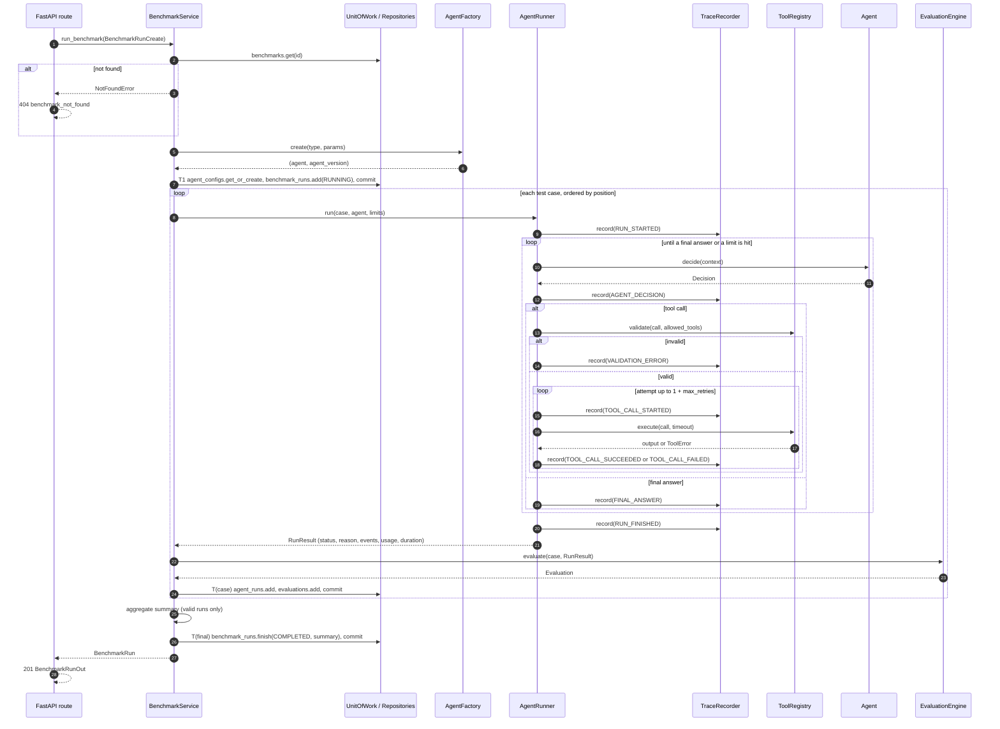

# AgentBench Component Interfaces and API Contracts

> **Status: Approved (2026-10-27).** This document refines [architecture.md](architecture.md)
> and uses the entities and enums from [data-model.md](data-model.md). Not yet
> implemented.

## 1. Component responsibilities

| Component | Responsible for | Not responsible for |
|-----------|-----------------|---------------------|
| `ToolRegistry` | Keeping the catalogue of tools; checking a call against a case's allow-list; validating arguments with each tool's Pydantic model; running a validated call with a timeout | Retries (`AgentRunner`), deciding what to call (`Agent`) |
| `TraceRecorder` | Assigning `seq`, `elapsed_us` and `occurred_at`; redacting and truncating payloads; holding events in memory in order | Saving events (repositories), interpreting them (`EvaluationEngine`) |
| `AgentRunner` | The loop; limits; retry and backoff; mapping every outcome to exactly one `TerminationReason`; **always returning a `RunResult`, never raising** for agent or tool failures | Scoring, saving, choosing an agent |
| `EvaluationEngine` | Pure `(test case, run result) → evaluation`; check results; the failure category; tool-correctness counts; estimated cost | Running anything, saving anything |
| Repositories + `UnitOfWork` | Converting between ORM rows and domain models; queries; the `UnitOfWork` owns the session and **is the only thing that commits** | Business rules, deciding where transactions begin and end (`BenchmarkService` decides) |
| `BenchmarkService` | Registration (idempotent); running a benchmark (per-case loop, transaction boundaries, aggregation); comparison; marking stale runs | HTTP concerns, SQL |
| FastAPI layer | Parsing requests into schemas; mapping domain errors to status codes and the error body; converting domain results to response schemas | Business logic: each route is a thin call into the service or a repository |

## 2. Python interfaces

These are the shapes the code will follow. The domain models referred to (`TestCase`,
`ToolCall`, `Decision`, `RunResult`, `TraceEvent`, `Evaluation`, …) are frozen Pydantic
models defined in milestone M2. Their fields mirror §4 and the data model.

```python
from __future__ import annotations

import uuid
from collections.abc import Callable, Mapping
from datetime import datetime, timedelta
from typing import Any, Protocol


class Clock(Protocol):
    """Injected so tests control time completely."""

    def now(self) -> datetime: ...  # UTC wall clock, used only for timestamps
    def monotonic_us(self) -> int: ...  # used for every duration
    async def sleep(self, seconds: float) -> None: ...  # retry backoff; instant in tests


class Tool(Protocol):
    name: str
    description: str
    args_model: type[Any]  # a Pydantic model class with extra="forbid"

    async def run(self, args: Any) -> ToolOutput: ...


class ToolRegistry:
    def register(self, tool: Tool) -> None: ...  # duplicate name -> ValueError at startup
    def names(self) -> frozenset[str]: ...
    def schemas(self) -> list[ToolSchema]: ...  # name, description, JSON schema of the args

    def validate(self, call: ToolCall, allowed: frozenset[str]) -> ValidatedToolCall:
        """Raises UnknownToolError, ToolNotAllowedError or ToolArgumentsError."""

    async def execute(self, call: ValidatedToolCall, timeout_s: float) -> ToolOutput:
        """Raises ToolTimeoutError or ToolExecutionError(retryable=...)."""


class Agent(Protocol):
    async def decide(self, context: AgentContext) -> Decision:
        """Returns a ToolCallDecision or FinalAnswerDecision, each with optional TokenUsage.

        context holds: the prompt, the case context, the schemas of the allowed tools,
        and the history of earlier decisions and observations.
        """


class AgentFactory(Protocol):
    def types(self) -> frozenset[str]: ...
    def create(self, agent_type: str, params: Mapping[str, Any]) -> tuple[Agent, str]:
        """Returns (agent, agent_version). Unknown type -> UnknownAgentTypeError."""


class TraceRecorder:
    def __init__(
        self, clock: Clock, redact: Callable[[dict[str, Any]], dict[str, Any]]
    ) -> None: ...

    def record(
        self, type: TraceEventType, step: int, payload: Mapping[str, Any]
    ) -> TraceEvent: ...  # assigns seq = number of events recorded so far

    def events(self) -> tuple[TraceEvent, ...]: ...


class AgentRunner:
    def __init__(self, registry: ToolRegistry, clock: Clock) -> None: ...

    async def run(self, case: TestCase, agent: Agent, limits: RunLimits) -> RunResult:
        """Always returns. An unexpected exception in the runner's own code becomes
        status=ERROR, termination_reason=HARNESS_ERROR, with the error message kept."""


class EvaluationEngine:
    version: str  # e.g. "eval-1"; bump it whenever a check changes meaning

    def __init__(self, prices: PriceTable) -> None: ...

    def evaluate(self, case: TestCase, run: RunResult) -> Evaluation: ...  # pure


class UnitOfWork(Protocol):
    benchmarks: BenchmarkRepository
    agent_configs: AgentConfigRepository
    benchmark_runs: BenchmarkRunRepository
    agent_runs: AgentRunRepository
    evaluations: EvaluationRepository

    def __enter__(self) -> UnitOfWork: ...
    def __exit__(self, *exc_info: object) -> None: ...  # rolls back unless commit() was called
    def commit(self) -> None: ...


class BenchmarkRepository(Protocol):
    def add(self, benchmark: Benchmark) -> None: ...  # including its test cases
    def get(self, benchmark_id: uuid.UUID) -> Benchmark | None: ...
    def find(self, name: str, version: str) -> Benchmark | None: ...
    def list_page(self, limit: int, offset: int) -> tuple[list[BenchmarkInfo], int]: ...


class AgentConfigRepository(Protocol):
    def get_or_create(self, config: AgentConfig) -> AgentConfig: ...  # keyed by config_hash


class BenchmarkRunRepository(Protocol):
    def add(self, run: BenchmarkRun) -> None: ...
    def get(self, run_id: uuid.UUID) -> BenchmarkRun | None: ...
    def list_page(
        self, benchmark_id: uuid.UUID | None, limit: int, offset: int
    ) -> tuple[list[BenchmarkRun], int]: ...
    def finish(
        self, run_id: uuid.UUID, status: BenchmarkRunStatus, finished_at: datetime,
        summary: Mapping[str, Any] | None,
    ) -> None: ...
    def stale_running(self, started_before: datetime) -> list[uuid.UUID]: ...


class AgentRunRepository(Protocol):
    def add(self, benchmark_run_id: uuid.UUID, result: RunResult) -> None: ...  # run + events
    def get(self, agent_run_id: uuid.UUID) -> AgentRunRecord | None: ...
    def list_for(self, benchmark_run_id: uuid.UUID) -> list[AgentRunRecord]: ...
    def events(self, agent_run_id: uuid.UUID) -> list[TraceEvent] | None: ...  # ordered by seq


class EvaluationRepository(Protocol):
    def add(self, agent_run_id: uuid.UUID, evaluation: Evaluation) -> None: ...
    def get(self, agent_run_id: uuid.UUID, evaluator_version: str) -> Evaluation | None: ...


class BenchmarkService:
    def __init__(
        self,
        uow_factory: Callable[[], UnitOfWork],
        runner: AgentRunner,
        engine: EvaluationEngine,
        agents: AgentFactory,
        tools: ToolRegistry,
        clock: Clock,
        max_cases: int = 200,
    ) -> None: ...

    def register_benchmark(self, definition: BenchmarkCreate) -> tuple[Benchmark, bool]:
        """Returns (benchmark, created). Same name+version+hash -> existing, False.
        Same name+version, different hash -> BenchmarkConflictError.
        Unregistered tool named in a case -> InvalidBenchmarkError."""

    def run_benchmark(self, request: BenchmarkRunCreate) -> BenchmarkRun: ...
    def compare(self, baseline_id: uuid.UUID, candidate_id: uuid.UUID) -> Comparison: ...
    def abort_stale(self, older_than: timedelta) -> int: ...
```

**Rules that apply across these interfaces**

- **Repositories return domain models, never ORM objects.** Otherwise lazy loading could
  happen after the session has closed (`DetachedInstanceError`), and ORM objects would
  leak into the API.
- **Repositories never call `commit()`.** Only `BenchmarkService` decides where a
  transaction ends, by calling `uow.commit()`.
- **The API never constructs ORM objects.** Read endpoints may use a repository directly
  through a read-only `UnitOfWork`; write endpoints always go through the service.

## 3. Pydantic API schemas

Shared conventions:
- `extra="forbid"`, so a misspelled YAML or JSON key is an error rather than being
  silently ignored;
- models are frozen (immutable once created);
- durations are exposed in milliseconds as floats;
- money is a `Decimal`, serialized as a string;
- `null` means "unknown or not reported", never zero.

```python
import uuid
from datetime import datetime
from decimal import Decimal
from typing import Annotated, Any, Generic, Literal, TypeVar

from pydantic import BaseModel, ConfigDict, Field, model_validator


class Schema(BaseModel):
    model_config = ConfigDict(extra="forbid", frozen=True)


Slug = Annotated[str, Field(pattern=r"^[a-z0-9][a-z0-9-]{0,99}$")]
ToolName = Annotated[str, Field(pattern=r"^[a-z][a-z0-9_]{0,63}$")]


# ---------- Requests: benchmark definitions ----------

class RunLimits(Schema):
    max_steps: int = Field(default=10, ge=1, le=100)
    tool_timeout_s: float = Field(default=5.0, gt=0, le=60)
    run_timeout_s: float = Field(default=60.0, gt=0, le=600)
    max_retries: int = Field(default=2, ge=0, le=5)


class RunLimitsOverride(Schema):
    max_steps: int | None = Field(default=None, ge=1, le=100)
    tool_timeout_s: float | None = Field(default=None, gt=0, le=60)
    run_timeout_s: float | None = Field(default=None, gt=0, le=600)
    max_retries: int | None = Field(default=None, ge=0, le=5)


class ExactAnswer(Schema):
    type: Literal["exact"]
    value: str
    case_sensitive: bool = False


class NumericAnswer(Schema):
    type: Literal["numeric"]
    value: float
    tolerance: float = Field(default=0.0, ge=0)


class RegexAnswer(Schema):
    type: Literal["regex"]
    pattern: str = Field(max_length=500)


class OneOfAnswer(Schema):
    type: Literal["one_of"]
    values: list[str] = Field(min_length=1)


AnswerExpectation = Annotated[
    ExactAnswer | NumericAnswer | RegexAnswer | OneOfAnswer, Field(discriminator="type")
]


class ToolExpectation(Schema):
    name: ToolName
    args_subset: dict[str, Any] = Field(default_factory=dict)


class Expectations(Schema):
    final_answer: AnswerExpectation
    required_tools: list[ToolExpectation] = Field(default_factory=list)
    forbidden_tools: list[ToolName] = Field(default_factory=list)
    max_tool_calls: int | None = Field(default=None, ge=0)
    allow_invalid_tool_calls: bool = False

    @model_validator(mode="after")
    def required_and_forbidden_are_disjoint(self) -> "Expectations":
        overlap = {t.name for t in self.required_tools} & set(self.forbidden_tools)
        if overlap:
            raise ValueError(f"tools both required and forbidden: {sorted(overlap)}")
        return self


class TestCaseCreate(Schema):
    key: Slug
    prompt: str = Field(min_length=1, max_length=20_000)
    context: dict[str, Any] = Field(default_factory=dict)
    allowed_tools: list[ToolName] = Field(default_factory=list, max_length=20)
    expectations: Expectations
    limits: RunLimitsOverride | None = None


class BenchmarkCreate(Schema):
    name: Slug
    version: str = Field(pattern=r"^[A-Za-z0-9._-]{1,50}$")
    description: str = Field(default="", max_length=2_000)
    test_cases: list[TestCaseCreate] = Field(min_length=1, max_length=500)

    @model_validator(mode="after")
    def keys_are_unique(self) -> "BenchmarkCreate":
        keys = [c.key for c in self.test_cases]
        if len(keys) != len(set(keys)):
            raise ValueError("test case keys must be unique")
        return self


# ---------- Requests: running ----------

class AgentConfigCreate(Schema):
    name: Slug
    type: Literal["scripted", "rule_based"]
    params: dict[str, Any] = Field(default_factory=dict)


class BenchmarkRunCreate(Schema):
    benchmark_id: uuid.UUID
    agent: AgentConfigCreate
    limits: RunLimitsOverride | None = None


# ---------- Responses ----------

class BenchmarkOut(Schema):
    id: uuid.UUID
    name: str
    version: str
    description: str
    content_hash: str
    test_case_count: int
    created_at: datetime


class TestCaseOut(Schema):
    id: uuid.UUID
    key: str
    position: int
    prompt: str
    context: dict[str, Any]
    allowed_tools: list[str]
    expectations: Expectations
    limits: RunLimitsOverride | None


class BenchmarkDetailOut(BenchmarkOut):
    test_cases: list[TestCaseOut]


class AgentConfigOut(Schema):
    id: uuid.UUID
    name: str
    type: str
    agent_version: str
    params: dict[str, Any]
    config_hash: str


class BenchmarkRunSummary(Schema):
    total_cases: int
    valid_runs: int
    invalid_runs: int  # HARNESS_ERROR runs, excluded from pass_rate
    passed: int
    failed: int
    pass_rate: float | None  # null when valid_runs == 0
    failure_categories: dict[FailureCategory, int]
    latency_ms_p50: float | None
    latency_ms_p95: float | None
    input_tokens: int | None  # null if any run did not report usage
    output_tokens: int | None
    estimated_cost_usd: Decimal | None
    evaluator_version: str
    pricing_version: str


class AgentRunListItem(Schema):
    id: uuid.UUID
    test_case_key: str
    status: AgentRunStatus
    termination_reason: TerminationReason
    passed: bool | None
    failure_category: FailureCategory | None
    duration_ms: float


class BenchmarkRunOut(Schema):
    id: uuid.UUID
    benchmark_id: uuid.UUID
    agent_config: AgentConfigOut
    status: BenchmarkRunStatus
    limits: RunLimits
    case_count: int
    git_sha: str | None
    started_at: datetime
    finished_at: datetime | None
    summary: BenchmarkRunSummary | None


class BenchmarkRunDetailOut(BenchmarkRunOut):
    runs: list[AgentRunListItem]


class CheckResultOut(Schema):
    name: str
    passed: bool
    failure_category: FailureCategory | None
    detail: str


class EvaluationOut(Schema):
    evaluator_version: str
    pricing_version: str
    passed: bool
    score: Decimal
    failure_category: FailureCategory | None
    checks: list[CheckResultOut]
    tool_calls_valid: int
    tool_calls_total: int
    estimated_cost_usd: Decimal | None


class AgentRunOut(Schema):
    id: uuid.UUID
    benchmark_run_id: uuid.UUID
    test_case_id: uuid.UUID
    test_case_key: str
    status: AgentRunStatus
    termination_reason: TerminationReason
    final_answer: str | None
    error_message: str | None
    step_count: int
    tool_call_count: int
    duration_ms: float
    input_tokens: int | None
    output_tokens: int | None
    started_at: datetime
    finished_at: datetime
    evaluation: EvaluationOut | None


class TraceEventOut(Schema):
    seq: int
    step: int
    type: TraceEventType
    occurred_at: datetime
    elapsed_ms: float
    payload: dict[str, Any]


class TraceOut(Schema):
    agent_run_id: uuid.UUID
    events: list[TraceEventOut]


class MetricDelta(Schema):
    baseline: float | None
    candidate: float | None
    delta: float | None  # candidate - baseline; null if either side is null


class ComparisonOut(Schema):
    baseline_id: uuid.UUID
    candidate_id: uuid.UUID
    benchmark_id: uuid.UUID
    evaluator_version: str
    pass_rate: MetricDelta
    latency_ms_p50: MetricDelta
    estimated_cost_usd: MetricDelta
    fixed: list[str]  # case keys: failed in baseline, passed in candidate
    broken: list[str]  # case keys: passed in baseline, failed in candidate
    unchanged_pass: int
    unchanged_fail: int


class ErrorBody(Schema):
    code: str
    message: str
    details: dict[str, Any] = Field(default_factory=dict)


class ErrorResponse(Schema):
    error: ErrorBody


T = TypeVar("T")


class Page(Schema, Generic[T]):
    items: list[T]
    total: int
    limit: int
    offset: int
```

## 4. Example API contracts

Every example below is checked against the schema named above it.

### 4.1 Register a benchmark — `POST /api/v1/benchmarks`

Request:
<!-- validate: BenchmarkCreate -->
```json
{
  "name": "inventory-math",
  "version": "1.0.0",
  "description": "Look up inventory and compute percentages.",
  "test_cases": [
    {
      "key": "percent-of-stock",
      "prompt": "What is 17% of the inventory count for SKU A-12?",
      "allowed_tools": ["kv_lookup", "calculator"],
      "expectations": {
        "final_answer": {"type": "numeric", "value": 20.4, "tolerance": 0.01},
        "required_tools": [{"name": "kv_lookup", "args_subset": {"key": "inventory:A-12"}}],
        "forbidden_tools": [],
        "max_tool_calls": 4
      }
    }
  ]
}
```

Responses:
- **`201 Created`** — `BenchmarkOut`, with a `Location: /api/v1/benchmarks/{id}` header.
- **`200 OK`** — the same name, version *and* content were already registered. The
  existing `BenchmarkOut` is returned, which makes the request idempotent.
- **`409`** — the same name and version, but different content:

<!-- validate: ErrorResponse -->
```json
{
  "error": {
    "code": "benchmark_version_conflict",
    "message": "inventory-math 1.0.0 already exists with different content",
    "details": {"existing_hash": "9f2c…", "submitted_hash": "41ab…"}
  }
}
```

- **`422`** — schema violations, or a case that names an unregistered tool
  (`code: invalid_benchmark`, with `details.unknown_tools`).

### 4.2 Run a benchmark — `POST /api/v1/benchmark-runs`

Request:
<!-- validate: BenchmarkRunCreate -->
```json
{
  "benchmark_id": "0b6f3c1e-8d7a-4a51-9a51-0c1f3b2e9d10",
  "agent": {"name": "scripted-baseline", "type": "scripted", "params": {}},
  "limits": {"max_steps": 5}
}
```

`201 Created`:
<!-- validate: BenchmarkRunOut -->
```json
{
  "id": "6a1d9e44-2c3b-4f8e-9d0a-5b7c8e1f2a33",
  "benchmark_id": "0b6f3c1e-8d7a-4a51-9a51-0c1f3b2e9d10",
  "agent_config": {
    "id": "c3e0b2a1-7f6d-4e5c-8b9a-1d2e3f4a5b6c",
    "name": "scripted-baseline",
    "type": "scripted",
    "agent_version": "scripted-1",
    "params": {},
    "config_hash": "5e884898da28047151d0e56f8dc6292773603d0d6aabbdd62a11ef721d1542d8"
  },
  "status": "COMPLETED",
  "limits": {"max_steps": 5, "tool_timeout_s": 5.0, "run_timeout_s": 60.0, "max_retries": 2},
  "case_count": 1,
  "git_sha": "025f2d8c1b9e4a7f3d6c2b1a0e9f8d7c6b5a4f3e",
  "started_at": "2026-10-27T14:03:11.204Z",
  "finished_at": "2026-10-27T14:03:11.231Z",
  "summary": {
    "total_cases": 1,
    "valid_runs": 1,
    "invalid_runs": 0,
    "passed": 1,
    "failed": 0,
    "pass_rate": 1.0,
    "failure_categories": {},
    "latency_ms_p50": 6.8,
    "latency_ms_p95": 6.8,
    "input_tokens": null,
    "output_tokens": null,
    "estimated_cost_usd": null,
    "evaluator_version": "eval-1",
    "pricing_version": "prices-2026-10"
  }
}
```

Errors:
- `404 benchmark_not_found`
- `413 too_many_cases` — more than `max_cases`
- `422` — unknown agent type, or invalid limits

### 4.3 Read a trace — `GET /api/v1/runs/{id}/events`

<!-- validate: TraceOut -->
```json
{
  "agent_run_id": "9d8c7b6a-5f4e-4d3c-8b2a-1f0e9d8c7b6a",
  "events": [
    {"seq": 0, "step": 0, "type": "RUN_STARTED", "occurred_at": "2026-10-27T14:03:11.210Z", "elapsed_ms": 0.0,
     "payload": {"limits": {"max_steps": 5, "tool_timeout_s": 5.0, "run_timeout_s": 60.0, "max_retries": 2}}},
    {"seq": 1, "step": 1, "type": "AGENT_DECISION", "occurred_at": "2026-10-27T14:03:11.211Z", "elapsed_ms": 0.4,
     "payload": {"kind": "tool_call", "call_id": "c1", "tool": "kv_lookup", "arguments": {"key": "inventory:A-12"}}},
    {"seq": 2, "step": 1, "type": "TOOL_CALL_STARTED", "occurred_at": "2026-10-27T14:03:11.211Z", "elapsed_ms": 0.5,
     "payload": {"call_id": "c1", "attempt": 1}},
    {"seq": 3, "step": 1, "type": "TOOL_CALL_FAILED", "occurred_at": "2026-10-27T14:03:13.212Z", "elapsed_ms": 2001.2,
     "payload": {"call_id": "c1", "attempt": 1, "error_type": "ToolTimeoutError", "retryable": true}},
    {"seq": 4, "step": 1, "type": "TOOL_CALL_STARTED", "occurred_at": "2026-10-27T14:03:13.313Z", "elapsed_ms": 2101.9,
     "payload": {"call_id": "c1", "attempt": 2}},
    {"seq": 5, "step": 1, "type": "TOOL_CALL_SUCCEEDED", "occurred_at": "2026-10-27T14:03:13.316Z", "elapsed_ms": 2104.6,
     "payload": {"call_id": "c1", "attempt": 2, "output": 120, "duration_ms": 2.7}},
    {"seq": 6, "step": 2, "type": "AGENT_DECISION", "occurred_at": "2026-10-27T14:03:13.317Z", "elapsed_ms": 2105.0,
     "payload": {"kind": "final_answer", "answer": "20.4"}},
    {"seq": 7, "step": 2, "type": "FINAL_ANSWER", "occurred_at": "2026-10-27T14:03:13.317Z", "elapsed_ms": 2105.1,
     "payload": {"answer": "20.4"}},
    {"seq": 8, "step": 2, "type": "RUN_FINISHED", "occurred_at": "2026-10-27T14:03:13.317Z", "elapsed_ms": 2105.2,
     "payload": {"status": "COMPLETED", "termination_reason": "COMPLETED"}}
  ]
}
```

Seq 3 and 4 show a retried timeout. Both attempts share `call_id: "c1"`, and the run
still completes.

### 4.4 Read one run with its evaluation — `GET /api/v1/runs/{id}`

A failing example. The agent never called the required `kv_lookup`; it guessed.

<!-- validate: AgentRunOut -->
```json
{
  "id": "1e2d3c4b-5a69-4788-9a6b-5c4d3e2f1a0b",
  "benchmark_run_id": "6a1d9e44-2c3b-4f8e-9d0a-5b7c8e1f2a33",
  "test_case_id": "7f6e5d4c-3b2a-4190-8f7e-6d5c4b3a2f1e",
  "test_case_key": "percent-of-stock",
  "status": "COMPLETED",
  "termination_reason": "COMPLETED",
  "final_answer": "17",
  "error_message": null,
  "step_count": 1,
  "tool_call_count": 0,
  "duration_ms": 0.9,
  "input_tokens": null,
  "output_tokens": null,
  "started_at": "2026-10-27T14:05:00.000Z",
  "finished_at": "2026-10-27T14:05:00.001Z",
  "evaluation": {
    "evaluator_version": "eval-1",
    "pricing_version": "prices-2026-10",
    "passed": false,
    "score": "0.5",
    "failure_category": "MISSING_REQUIRED_TOOL",
    "checks": [
      {"name": "final_answer", "passed": false, "failure_category": "WRONG_ANSWER", "detail": "expected 20.4 ± 0.01, got 17"},
      {"name": "required_tools", "passed": false, "failure_category": "MISSING_REQUIRED_TOOL", "detail": "kv_lookup was never called"},
      {"name": "forbidden_tools", "passed": true, "failure_category": null, "detail": ""},
      {"name": "max_tool_calls", "passed": true, "failure_category": null, "detail": "0 ≤ 4"}
    ],
    "tool_calls_valid": 0,
    "tool_calls_total": 0,
    "estimated_cost_usd": null
  }
}
```

Both checks failed, but the precedence order (data-model §5.3) reports
`MISSING_REQUIRED_TOOL` as the primary category, because skipping the lookup is the
cause of the wrong answer.

### 4.5 Compare — `GET /api/v1/comparisons?baseline_id=…&candidate_id=…`

<!-- validate: ComparisonOut -->
```json
{
  "baseline_id": "6a1d9e44-2c3b-4f8e-9d0a-5b7c8e1f2a33",
  "candidate_id": "b2c3d4e5-f6a7-4b8c-9d0e-1f2a3b4c5d6e",
  "benchmark_id": "0b6f3c1e-8d7a-4a51-9a51-0c1f3b2e9d10",
  "evaluator_version": "eval-1",
  "pass_rate": {"baseline": 0.6, "candidate": 0.8, "delta": 0.2},
  "latency_ms_p50": {"baseline": 6.8, "candidate": 7.4, "delta": 0.6},
  "estimated_cost_usd": {"baseline": null, "candidate": null, "delta": null},
  "fixed": ["percent-of-stock"],
  "broken": [],
  "unchanged_pass": 3,
  "unchanged_fail": 1
}
```

Comparison rules:
- The two benchmark runs must be of the **same benchmark id**, so the same version and
  content. Otherwise the response is `422 benchmark_version_mismatch`.
- Both sides use the same `evaluator_version`. If the candidate was scored with a newer
  evaluator, the baseline must be re-scored first; otherwise the response is
  `422 evaluator_version_mismatch`.

## 5. Errors

### 5.1 Error types and HTTP mapping

```
AgentBenchError
├── NotFoundError(resource, id)                     → 404  <resource>_not_found
├── ConflictError
│   └── BenchmarkConflictError                      → 409  benchmark_version_conflict
├── InvalidRequestError
│   ├── InvalidBenchmarkError (unknown tools, …)    → 422  invalid_benchmark
│   ├── UnknownAgentTypeError                       → 422  unknown_agent_type
│   ├── BenchmarkVersionMismatchError               → 422  benchmark_version_mismatch
│   └── EvaluatorVersionMismatchError               → 422  evaluator_version_mismatch
├── LimitExceededError
│   └── TooManyCasesError                           → 413  too_many_cases
└── ToolError        (recorded in the trace, never reaches the API)
    ├── UnknownToolError                           not retried
    ├── ToolNotAllowedError                        not retried
    ├── ToolArgumentsError(field_errors)           not retried
    ├── ToolTimeoutError                           retried (bounded)
    └── ToolExecutionError(retryable: bool)        retried only if retryable
```

**Errors from outside the domain:**
- Pydantic request validation errors → `422 validation_error`, with
  `details.errors` taken from Pydantic's error list.
- `sqlalchemy.exc.OperationalError` (the database can't be reached) →
  `503 database_unavailable`.
- Anything else → `500 internal_error` with a generic message. The full stack trace is
  logged on the server with a request id, and that id is returned in `details.request_id`.

### 5.2 Mapping from termination reason to failure category

| Termination reason | Status | Failure category if not passed |
|--------------------|--------|-------------------------------|
| `COMPLETED` | `COMPLETED` | From the checks (§5.3 of data-model.md) |
| `MAX_STEPS_EXCEEDED` | `FAILED` | `STEP_LIMIT` |
| `RUN_TIMEOUT` | `FAILED` | `TIMEOUT` |
| `TOOL_FAILURE_EXHAUSTED` | `FAILED` | `TOOL_FAILURE` |
| `AGENT_ERROR` | `FAILED` | `AGENT_ERROR` |
| `HARNESS_ERROR` | `ERROR` | `HARNESS_ERROR` (excluded from the pass rate) |

## 6. Transaction boundaries

| Operation | Transaction(s) | Concurrency handling |
|-----------|----------------|----------------------|
| `register_benchmark` | One: insert the benchmark and all test cases | Two concurrent registrations of the same name and version: one insert fails with `IntegrityError` on `uq_benchmark_name_version`. The service rolls back, reads the existing row, and returns it (same hash) or raises `BenchmarkConflictError` (different hash). |
| `AgentConfig.get_or_create` | Part of transaction T1 below | `INSERT … ON CONFLICT (config_hash) DO NOTHING`, then `SELECT`. Safe under concurrency with no retry loop. |
| `run_benchmark` — start | **T1:** get-or-create the agent config; insert `BENCHMARK_RUN(status=RUNNING)`; commit | — |
| `run_benchmark` — each case | **T2…Tn+1:** insert `AGENT_RUN`, bulk-insert its `TRACE_EVENT`s, insert `EVALUATION_RESULT`; commit | The runner and evaluator work in memory, with **no transaction open** while the agent runs |
| `run_benchmark` — finish | **Tn+2:** set status `COMPLETED`, `finished_at`, and `summary`; commit | — |
| `run_benchmark` — saving a case fails | Roll back that case; finish with `ABORTED` and a partial summary; re-raise | Never `COMPLETED` with a missing case |
| `abort_stale` | One: `UPDATE … SET status='ABORTED' WHERE status='RUNNING' AND started_at < :cutoff` | — |
| Re-scoring (later) | One per benchmark run: insert new `EVALUATION_RESULT` rows for a new evaluator version | Never updates or deletes old evaluations |

## 7. Sequence: one benchmark run, in detail



## 8. Testing requirements

Unit tests use a `FakeClock` (time moves only when the test advances it, and
`sleep` returns immediately). No unit test touches the network or a database.

| Component | Required tests |
|-----------|----------------|
| Schemas | Every example in §4 validates. An unknown key is rejected (`extra="forbid"`). Duplicate case keys are rejected. A tool both required and forbidden is rejected. Each answer type is selected correctly by `type`. Out-of-range limits are rejected. |
| `ToolRegistry` | Registering a duplicate name raises. An unknown tool raises `UnknownToolError`. A tool outside the allow-list raises `ToolNotAllowedError`. Missing, extra and wrongly typed arguments raise `ToolArgumentsError` with field paths. A timeout raises `ToolTimeoutError` (with a slow fake tool). `schemas()` matches each tool's `args_model`. |
| Mock tools | `calculator` gives correct arithmetic, and rejects names, attribute access, calls and huge exponents. `kv_lookup` handles found and missing keys. Fault injection fails exactly *N* times and then succeeds. |
| `TraceRecorder` | `seq` is 0..n-1 with no gaps. `elapsed_us` never decreases (with `FakeClock`). Redaction is applied. A payload over 16 KiB is truncated with `truncated` and `original_bytes`. `events()` returns an immutable snapshot. |
| `AgentRunner` | One test per `TerminationReason`. Retry count is never more than `max_retries`. Backoff calls `clock.sleep` with the expected delays. A validation error is not retried and is passed back to the agent. The run deadline is checked before each decision. An exception in the runner's own code gives `HARNESS_ERROR`, not a crash. The run summary counts equal the counts recomputed from events. The same case run twice gives identical traces once timestamps are removed (golden file). |
| `EvaluationEngine` | Each check passes and fails at least once. The failure-category precedence is tested with several checks failing together. A non-`COMPLETED` run never passes. Cost is `NULL` when tokens are `NULL`. Calling `evaluate` twice gives equal results (purity). |
| Repositories | Round-trip each entity, domain → database → domain, field for field. `seq` order is preserved on read. Each constraint rejects bad data, for example a COMPLETED run without an answer, or `passed` with a failure category. Cascade deletes remove events and evaluations. `RESTRICT` blocks deleting a benchmark that has runs. `get_or_create` is safe when run concurrently (two sessions). |
| `BenchmarkService` | Registration: created, idempotent repeat, conflict, unknown tool. Running: per-case commits survive a failure injected at case *k* (cases before *k* are saved, the benchmark run is `ABORTED`). Harness errors are excluded from the pass rate. Comparison: fixed and broken lists; version mismatch errors. `abort_stale` updates only old `RUNNING` rows. |
| FastAPI | Each endpoint returns its success status and body schema. Each documented error code is produced. Every error body matches `ErrorResponse`. A 500 contains no stack trace. Pagination limits are enforced. The OpenAPI document builds. |
| Migrations | An empty database upgrades to head. The resulting schema matches the ORM metadata (Alembic autogenerate shows no differences). |
| Dashboard | API client functions are tested against a fake transport. Pages render with empty data and with error responses (smoke test only). |
