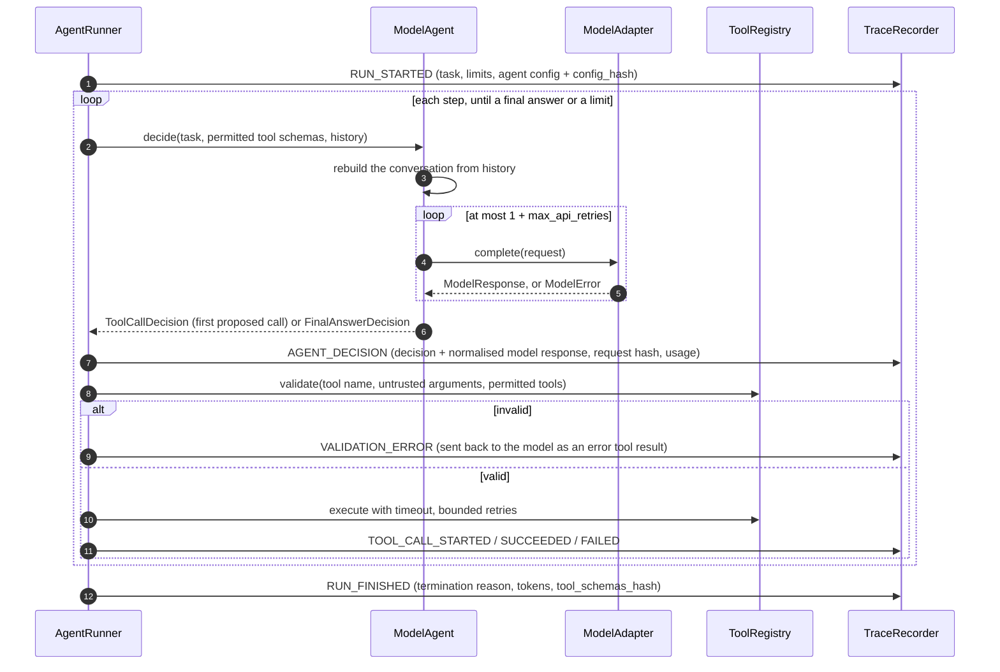

# Model Agents, Versioning, and Replay

How AgentBench runs a language model as an agent, versions its configuration, and
re-runs past work.

Code:
- `src/agentbench/llm/` — the model interface and adapters;
- `src/agentbench/agents/model_agent.py` — the model-backed agent;
- `src/agentbench/experiments/` — replay and experiments.

## 1. Provider-independent interface

`ModelAdapter.complete(ModelRequest) -> ModelResponse` is the only thing the rest of
AgentBench knows about a model.

| Type | Contents |
|------|----------|
| `ModelRequest` | Model id, system prompt, conversation (`UserMessage`, `AssistantMessage`, `ToolResultsMessage`), permitted tool schemas, `DecodingSettings`, timeout |
| `ModelResponse` | Text and/or proposed tool calls, a normalised stop reason (`end_turn`, `tool_use`, `max_tokens`, `refusal`, `other`), the provider's own stop reason, `TokenUsage` or `None`, response id, the model that actually answered, and the provider's raw content blocks |
| `ModelError` | `ModelTimeoutError` and `ModelRateLimitError` (retryable); `ModelProviderError` (retryable for 5xx, 408, 409 and connection failures; not retryable for other 4xx); `MalformedModelResponseError` (not retryable) |

Every adapter applies the same structural checks (`check_response`). A response is
rejected as malformed when:
- it says `tool_use` but has no tool call;
- it has neither text nor a tool call;
- it repeats a tool-call id.

**Adapters:**

| Adapter | Use |
|---------|-----|
| `AnthropicAdapter` | Anthropic Messages API through the official `anthropic` SDK (install `agentbench[anthropic]`) |
| `ScriptedModelAdapter` | A fake model for tests. It returns or raises pre-written items, and never touches the network. |
| `RecordedResponseAdapter` | Answers with the responses recorded in an earlier run (§5) |

**`AnthropicAdapter` request settings:**
- tools are sent with `tool_choice: auto` and parallel tool use disabled;
- `effort` is sent through `output_config`;
- **no sampling parameters** are sent (current models reject `temperature` / `top_p`).

**Retries and fallbacks:**
- The SDK's own retries are turned off; `ModelAgent` retries, so every attempt is
  counted in the trace.
- Refusal fallbacks to another model are **not** enabled. In a benchmark, the configured
  model must be the one that answers; `ModelResponse.model` records which one did.

**Credentials** come from the environment (`ANTHROPIC_API_KEY`; see `.env.example`).
AgentBench never reads, stores, or logs a key. **No test uses credentials or the
network**: the adapter tests drive the real SDK through a fake HTTP transport.

## 2. The controlled tool-calling loop



1. **Send** the conversation and the schemas of the task's *permitted* tools only.
2. **Validate** the proposed call. The tool name and arguments are untrusted input:
   unknown tools, tools the task doesn't allow, and schema-invalid arguments are rejected
   before anything runs. The model's output is never executed as code. The calculator,
   for example, accepts only an allow-list of arithmetic syntax.
3. **Execute** only the validated call, with a per-call timeout and bounded retries.
4. **Append** the result. On the next step, `ModelAgent` rebuilds the conversation from
   the history:
   - each assistant turn is sent back exactly as recorded (the provider's raw content
     blocks, unchanged);
   - each tool result becomes an `is_error` tool result if the call failed.
5. **Continue** until a final answer, or until a limit is hit (`max_steps`, the run
   deadline).
6. **Record** every step in the trace. `TaskRunService` / `BenchmarkRunner` then save
   the run, its events and its evaluation.

**One tool call per step.** Parallel tool use is disabled in the request. If a response
still proposes several calls, only the first runs, and the others get an explicit "not
executed" error result, so the model can ask for them again. The trace records them
under `unexecuted_tool_calls`.

**The agent is stateless.** Each decision stores the normalised model response in its
metadata, and the next request is rebuilt from that alone. So the trace contains
everything needed to reproduce the conversation, and an agent instance can't leak state
from one task into another.

### Failure handling

| Situation | Result | Evaluation |
|-----------|--------|------------|
| Timeout, rate limit, 5xx, connection error | Retried up to `max_api_retries`, with backoff (`api_retry_backoff_s × 2^(n−1)`, or the provider's `retry-after`) | — |
| …still failing after the retries | `MODEL_UNAVAILABLE` | **INVALID** (infrastructure) |
| Authentication, permission, bad request (not retryable) | `MODEL_UNAVAILABLE` immediately | **INVALID** |
| Malformed response | `AGENT_ERROR` | FAILED (the model's fault) |
| Cut off at `max_output_tokens`, or a refusal | `AGENT_ERROR` | FAILED |
| Unknown tool, invalid arguments | `VALIDATION_ERROR`, shown to the model | `INVALID_TOOL_CALL` if the case forbids invalid calls |
| The same call repeated forever | Stops at `MAX_STEPS_EXCEEDED` | `STEP_LIMIT` |
| No usage in a response | Run token totals become `None` (not 0); cost is unavailable | — |

## 3. Versioning

`ModelAgentConfig` contains everything that can change a model agent's behaviour:
- provider and model id;
- prompt id, version, and text;
- decoding settings (`max_output_tokens`, `effort`, stop sequences);
- API timeout and retry settings.

Its `config_hash` is the SHA-256 of the canonical JSON of all of these except the
display `label`. The agent's version is `<prompt id>@<prompt version>+<hash prefix>`, for
example `inventory@1+2ac3f4768907`.

| Recorded where | What |
|----------------|------|
| `RUN_STARTED.payload.agent.config` | The full configuration and its hash |
| `agent_run.agent_config_hash` (indexed) | Groups runs by configuration |
| `agent_run.tool_schemas_hash`, `RUN_FINISHED`, each decision's metadata | Hash of the exact tool schemas the model was shown: the tool configuration |
| Each decision's metadata | The normalised model response, the request hash, the number of API attempts |
| `agent_run.execution_mode`, `agent_run.source_run_id` | How the run was produced, and which run it re-executes |

**The same `config_hash` means the same configuration, not the same behaviour.**

## 4. Replay is not re-execution

| Mode | What runs | Deterministic? | Use it to |
|------|-----------|----------------|-----------|
| `TRACE` | Nothing. The stored run is re-scored. | Yes | Re-check a verdict; score again with a new evaluator version |
| `RECORDED_RESPONSES` | The tools run again; every model request is answered from the stored trace | Yes if the tools are. Divergence is detected by comparing request hashes, and reported. | Check that tools and harness still behave the same; find tool drift |
| `LIVE_SAME_CONFIG` | Everything, with a live model and the same configuration | **No.** Differences are expected and are not by themselves a bug. | Measure run-to-run variation |
| `NEW_CONFIG` | Everything, with a different model, prompt, or settings | No | An experiment, not a replay |

Re-executed runs are stored with `execution_mode` and `source_run_id`.

```bash
uv run agentbench replay <run-id> --mode trace
uv run agentbench replay <run-id> --mode recorded --save
uv run agentbench replay <run-id> --mode live --agent-config examples/agents/opus-inventory-v2-terse.json
```

`replay` rebuilds the test case from the stored task and the criteria stored with the
run's evaluation. The run must therefore have been evaluated (`bench --save` does this).

## 5. Experiments

`ExperimentService.compare(benchmark, baseline, candidate, adapter_for)` runs the same
benchmark with two configurations, using the same tools, limits, and evaluator. It
returns:
- both summaries;
- the comparison: percentage-point changes, fixed and broken cases, failure
  distributions;
- the configuration fields that changed;
- notes. With a live provider, a note always states that **one run per case cannot show
  whether a difference would repeat**.

From the command line, an experiment is two `bench` runs and a `compare`:

```bash
set -a; source .env; set +a      # ANTHROPIC_API_KEY; live calls cost money
uv run agentbench bench examples/benchmarks/inventory-v1.json --label v1 \
  --agent-config examples/agents/opus-inventory-v1.json --save --output v1.json
uv run agentbench bench examples/benchmarks/inventory-v1.json --label v2 \
  --agent-config examples/agents/opus-inventory-v2-terse.json --save --output v2.json
uv run agentbench compare v1.json v2.json
```

## 6. Testing

All model behaviour is tested with `ScriptedModelAdapter`, or with the real SDK behind a
fake HTTP transport. **CI needs no API key and makes no paid calls.**

Covered:
- malformed tool calls and arguments;
- an unknown tool;
- code in the calculator's arguments;
- repeated identical calls reaching the step limit;
- extra parallel calls;
- malformed, empty, truncated, and refused responses;
- timeouts, rate limits with `retry-after`, 5xx and non-retryable errors;
- missing usage metadata;
- every replay mode, including detected divergence and tampered configurations;
- experiments.

## 7. Limitations

- **No live result is documented here.** Nothing in this repository has been run against
  a live model.
- **Streaming is not used.** With large `max_output_tokens`, slow responses rely on the
  request timeout.
- **One tool call per step.** Parallel tool use is turned off rather than supported.
- **Usage is input and output tokens only.** Cache tokens are not recorded separately
  yet.
- **Experiments run each case once.** There are no repeated runs and no confidence
  intervals yet.
