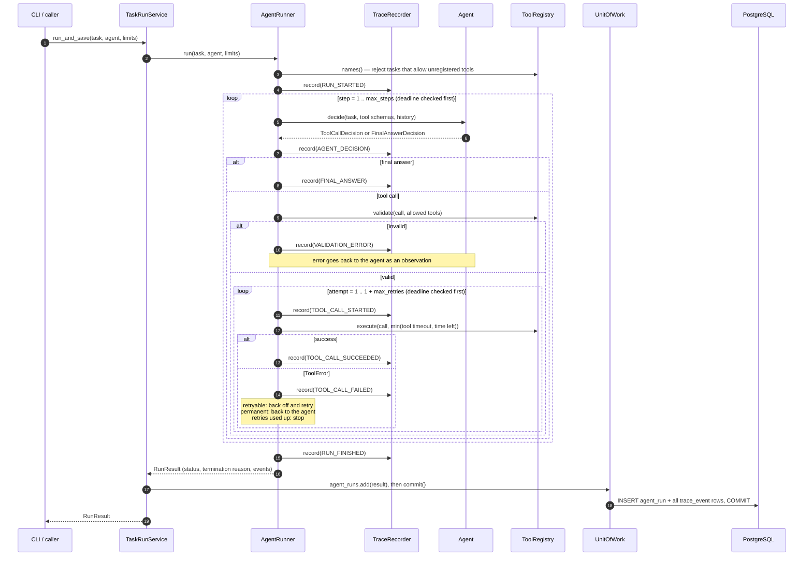

# Runner, Tools, and Trace Persistence

This document describes what is **implemented** today: the deterministic agent runner,
the tool registry and mock tools, trace recording, and PostgreSQL persistence of runs and
traces. For the overall design see [architecture.md](architecture.md); for the planned
full schema see [data-model.md](data-model.md).

## 1. Components

| Module | Responsibility |
|--------|----------------|
| `domain/` | Frozen Pydantic models (`Task`, `RunLimits`, decisions, `Observation`, `TraceEvent`, `RunResult`), enums, and error types. `RunResult` rejects contradictory data. |
| `tools/registry.py` | `ToolRegistry`: rejects invalid tool definitions; validates every call (unknown tool, tool not allowed, arguments not an object, schema errors); runs tools with a timeout and turns every failure into a `ToolError`. |
| `tools/mock/` | `search_records`, `lookup_record`, `calculator` over a fixed in-memory dataset, plus `FaultInjectingTool` for tests. |
| `agents/` | `RuleBasedAgent` (documented deterministic policy) and `ScriptedAgent` (replays fixed decisions). |
| `tracing/` | `TraceRecorder` (event ids, gap-free `seq`, timestamps, payload copying, truncation, redaction hook); `SystemClock` and `FakeClock`. |
| `runner/runner.py` | `AgentRunner`: the loop, limits, retries, and termination reasons. |
| `persistence/` | SQLAlchemy tables, `AgentRunRepository`, `UnitOfWork`. |
| `service.py` | `TaskRunService`: run a task, then save the run and its trace in one transaction. |
| `cli.py` | `agentbench run` / `agentbench show`. |

## 2. Sequence

The agent runs with no database transaction open. The run and all its events are then
saved in a single transaction, so a stored run never has a partial trace.

## 3. Termination

Every run ends with exactly one termination reason, recorded in `RUN_FINISHED` and on
the `agent_run` row:

| Reason | Status | When |
|--------|--------|------|
| `COMPLETED` | `COMPLETED` | The agent returned a final answer. This says nothing about whether the answer is *correct*. |
| `MAX_STEPS_EXCEEDED` | `FAILED` | `max_steps` decisions were made without a final answer. |
| `RUN_TIMEOUT` | `FAILED` | The run deadline passed. The deadline is checked before each decision and before each tool attempt, so no tool call starts after it. |
| `TOOL_FAILURE_EXHAUSTED` | `FAILED` | A retryable tool error (timeout or transient failure) happened on every one of `1 + max_retries` attempts. |
| `AGENT_ERROR` | `FAILED` | The agent raised an exception, returned something that is not a decision, or returned arguments that are not JSON. |
| `HARNESS_ERROR` | `ERROR` | An unexpected exception in AgentBench's own code. |

**How errors are handled:**
- **Validation errors and permanent tool errors** are *not* retried. They go back to the
  agent as an observation with `ok: false`, so it can try something else.
- **Retryable errors** are retried with exponential backoff: `retry_backoff_s × 2^(attempt−1)`.
- **A tool's output reaches the agent only if the tool actually succeeded.** A failed
  call has no output.

## 4. The deterministic policy

`RuleBasedAgent` supports five prompt patterns. The full list is in the docstring of
`src/agentbench/agents/rule_based.py`. Examples:

| Prompt | Tool calls | Answer |
|--------|-----------|--------|
| `What is the quantity of record A-12?` | `lookup_record` | `120` |
| `What is 17% of the quantity of record A-12?` | `lookup_record` → `calculator` | `20.4` |
| `Find records matching 'cable'` | `search_records` | `B-07, B-09` |
| `What is the total value of records matching 'cable'?` | `search_records` → `calculator` | `468` |
| `Compute (12 + 8) * 3` | `calculator` | `60` |

**When a tool call fails**, the agent answers `unable to answer: <error type>: <message>`
rather than guessing. That run still ends `COMPLETED`, because the agent *did* produce a
final answer. Judging whether the answer is correct is the evaluator's job (a later
milestone).

**A prompt that matches no pattern** raises `UnsupportedTaskError`, and the run ends
with `AGENT_ERROR`.

## 5. Tools and validation

| Tool | Arguments | Failure behaviour |
|------|-----------|-------------------|
| `search_records` | `query` (1–100 characters), `category?`, `limit` (1–20, default 5) | No match returns an empty list, not an error. Results are sorted by id. |
| `lookup_record` | `record_id` matching `^[A-Z]{1,3}-\d{1,4}$` | An unknown id is a permanent `ToolExecutionError`. |
| `calculator` | `expression` (1–200 characters) | Syntax outside the allow-list is rejected *during validation*. Division by zero, huge results, and large or fractional exponents are permanent errors. |

**Argument models must reject unknown fields** (`extra="forbid"`) and validate strictly;
the registry refuses to register a tool whose argument model does not.

**The calculator never uses `eval`.** It parses the expression into a syntax tree and
accepts only number literals, `+ - * / // % **`, unary `+ -`, and parentheses.

## 6. Trace events

Every event has:
- `id` — the event id;
- `run_id`;
- `seq` — 0, 1, 2, … with no gaps, unique per run;
- `step` — the agent step it belongs to;
- `type`;
- `occurred_at` — UTC wall-clock time;
- `elapsed_us` — microseconds since the run started, from a monotonic clock;
- `payload` — a JSON object.

**Order comes from `seq`, never from timestamps.** Each run has a single recorder, so a
counter is enough to give the true order.

**The recorder copies each payload through JSON.** It raises on values that are not
JSON (rather than turning them into strings), truncates payloads over 16 KiB with a
visible `truncated` marker, and applies an optional redaction hook.

## 7. Persistence

**Tables:** `agent_run` (one row per run) and `trace_event` (one row per event). They
are created by Alembic migration `0001`.

**Rules enforced by the database:**
- the status matches the termination reason;
- a `COMPLETED` run has an answer;
- counts and durations are non-negative;
- `finished_at` is not before `started_at`;
- enum values are valid (stored as `VARCHAR` with a CHECK constraint);
- `(agent_run_id, seq)` is unique;
- deleting a run deletes its events (`ON DELETE CASCADE`).

**`agent_run.task` keeps a JSON snapshot of the task as it was run**, so a stored run
can be reproduced even after the task definition changes.

## 8. Testing strategy

| Layer | How |
|-------|-----|
| Unit tests (`tests/unit/`) | No database and no network. `FakeClock` makes timeouts and backoff instant and repeatable. The 19-task suite in `test_task_suite.py` asserts the exact event sequence for each scenario. |
| Integration tests (`tests/integration/`, marker `postgres`) | Run against a real PostgreSQL, never SQLite. |

**The test database:**
1. Once per test session, a uniquely named database is created on the server given by
   `AGENTBENCH_TEST_DATABASE_URL` and migrated with **Alembic**. The migrations
   themselves are therefore tested, not `create_all`.
2. Each test runs inside an outer transaction that is always rolled back. Sessions
   join it using savepoints, so code under test can call `commit()` normally.
3. The database is dropped at the end of the session.

**Trade-offs of this approach:**

| Option | Benefit | Cost | Used? |
|--------|---------|------|-------|
| SQLite in memory | No server; very fast | Behaves differently from PostgreSQL in JSONB, time zones, and CHECK handling, so bugs would hide | No |
| One shared database, cleaned between tests | Simple | Tests can leak data into each other; can't run in parallel | No |
| New database per test | Perfect isolation | Running migrations for every test is slow | Only for migration tests |
| Database per session + rollback per test | Isolated and fast; migrations exercised once | Can't test code that opens its own connections, or real concurrency between transactions | **Yes** |
| testcontainers (start a container from inside pytest) | No manual setup | Needs Docker in every environment; slower start | No; Compose locally and a service container in CI do the same job |

**Without `AGENTBENCH_TEST_DATABASE_URL`**, the integration tests are *skipped* with a
reason. **In CI**, `AGENTBENCH_REQUIRE_POSTGRES=1` turns that skip into a failure, so
the PostgreSQL tests can never be skipped silently.

## 9. Known limitations

- **No evaluation yet.** `COMPLETED` means "gave an answer", not "gave the right answer".
- **Runs are standalone.** There are no benchmark, test-case, or agent-configuration
  tables yet (see data-model.md §7).
- **Timeouts can't stop CPU-bound code.** A tool that never awaits cannot be cancelled
  by `asyncio.wait_for`. The mock tools always return quickly.
- **No token usage or cost yet.** The deterministic agents use no model.
- **`RuleBasedAgent` understands only five fixed prompt patterns.** It is a test agent,
  not a language model.
